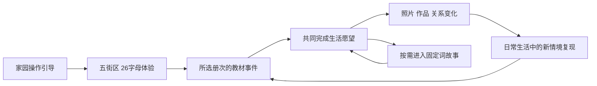

# 字母岛 · 游戏设计文档（GDD）

版本：1.0 策划整合基线（2026-10-22）；实施状态更新：2026-10-24（Asia/Shanghai）。适用项目：StudyGames V3 / LoveStudy，当前工程版本 **0.11.0-dev**。

本文汇总主线、八册单词故事与动态美术策划，并统一它们之间的规则。**“最终策划”表示本轮已经对齐的制作基线，不表示游戏已经实现这些内容，也不替代后续教材编辑、人物图像核对和儿童试玩。**

## 1. 文档权责与证据

用户已经确定：先认识 26 个字母并探索全岛，再按课本开展生活事件；单词按每个字母调用固定地标形象，形成联系词义、有先后顺序的故事；想不出时有逐步帮助；增加风、水、天气、日照与昼夜；首批 NPC 覆盖教材人物，人形考虑 Mixamo，复杂模型后续可用 Tripo 替换。

本 GDD 规定跨系统规则和制作范围。下面三套文件是它的详细设计与数据附录，保留来源、细节和独立核验记录，不复制上千张故事卡到本文：

| 资料 | 负责内容 | 不可由它单独证明的内容 |
|---|---|---|
| [主线策划](docs/planning/mainline/README.md) | 序章、81 单元事件、首章流程、状态和奖励 | 全教材逐项审校、实际游戏完成 |
| [词汇故事策划](docs/planning/vocabulary/README.md) | 正式词表、逐字母故事、义项、来源、帮助与迁移 | 课文全部语句游戏化、学习效果 |
| [美术资产策划](docs/planning/art/README.md) | 环境、教材人物、动作、记忆表现与替换管线 | 模型已绑定、动作质量或设备性能通过 |
| [整合核查记录](docs/planning/integration/冲突核查与整合记录.md) | 冲突、裁定、修改位置和检查范围 | 未检查内容的验收 |
| [联合核验报告](docs/planning/integration/integration_summary.json) | 本次读取版本、计数、关联与一致性检查 | 人工教学审校和儿童试用 |

教材原图、原文与版本信息负责教学事实。游戏新编对白、生活事件、动作分工须标为创作。发现事实与策划不符时先修订设计，不用 GDD 覆盖教材证据。域文档有新变化时须同步其机器数据、GDD 和联合检查；发生尚未裁定的矛盾时禁止凭旧文档默默实施。

## 2. 产品定位与体验

字母岛是一款面向小学英语学习者的生活模拟游戏。孩子扮演岛上的新居民和新同学，在自己的家、学校和邻里之间生活，和朋友共同完成事情，通过英语理解需求、表达想法、参与活动。

玩家看见的主线是“我和朋友让小岛的生活更丰富”。设计同时维护两条学习线：教材知识在合适的生活情境中出现和复现；固定字母形象帮助建立、提取完整拼写和词义。游戏不把拼写链当成发音规律，也不把生活成果直接换算成英语掌握度。

首个交互验证以三年级初学者为起点，长期内容覆盖当前八册教材。首先使用现有 Windows 离线客户端；其他平台另做输入、性能与发布验收。一次活动先以可中断的约 10–15 分钟作为试玩起点，街区可分成每次 2–3 站；这些时长均待试玩调整，不是强制限时。

体验原则：

- 每段先给出看得懂的生活愿望，再提供可操作过程，最后留下看得见的结果。
- 提示随时可用，可以直接看完整示范；不付费、不扣叶币、不扣成果、不以独立答对锁住剧情。
- 自由选择称呼、外观、装饰和个人故事；英语任务的目标与证据保持明确。
- 随时退出、回家或下次继续，不用连续登录、等待现实天气或重复刷题换取主线资格。
- 已有地图、素材、存档与生活能力继续使用；新增设计不要求重建一座岛或清空旧进度。

## 3. 当前工程与目标版本

当前工程为 Godot 4.7 系列、GL Compatibility，默认视口 1440×900，最小窗口 960×640。v0.11.0-dev 统一常驻界面、旅行册目录和弹窗层级，见 [主界面更新记录](docs/verification/main-ui/README.md)。此前 v0.10.0-dev 在既有 P0–P2 和朋友角基础上，接入 TR-01/TR-02 发现作品、U3 欢迎桌与四幕聚会、八位朋友的已保存事实回应；入口和操作见 [游玩说明](docs/Blender地图版游玩说明.md)，验证范围见 [生活纪念记录](docs/verification/life-keepsakes/README.md)。以下表格保留 2026-10-22 策划整合时的 v0.4.0 静态基线，不能用它否认后续已经实现的功能。

| 系统 | 历史 0.4.0 的静态证据 | 本 GDD 的新增目标 |
|---|---|---|
| 地图 | 主岛 + 35 个子场景，共 36；A–Z、家园、校园及七个校园功能场所 | 复用空间编排序章与连续生活事件 |
| 操作与生活 | 点击/键盘移动、交谈、苹果委托、蛋糕、装修、衣橱、校园活动、保存 | 角色同行、共同成果、跨章关系和可恢复多步事件 |
| 课程 | 三上前三单元的 9 道情境题、18 条表达、18 条已打包合成语音 | 按八册单元逐章制作，连接正式词表与故事模块 |
| 角色 | 程序拼接模型；主角已有部分程序动作 | 教材人物身份、蒙皮骨架、共享动作、日程和特殊体型 |
| 环境 | 固定光照和“晴”状态；不是持续天气/昼夜系统 | 轻柔风水、四种天气、晨昼暮夜、暂停与舒适设置 |
| 词故事 | 全量内容策划已落盘 | 内容导入、表现组件、提示日志、真实回忆记录 |

上述 36 个地图 GLB 的历史基线检查没有发现 skin 或动画片段；这不代表后来接入的独立角色资产没有蒙皮。详见[工程与资产基线](docs/planning/art/current_baseline.json)和后续[角色美术记录](docs/verification/art-finish-v3/README.md)。没有语音识别评分、自由口语自动判定或开放式 AI 对话的已验证能力；首章不依赖这些功能。

## 4. 世界结构与固定字母编码

主岛 `village` 连接 26 个 `landmark_A` 至 `landmark_Z`，以及 `home` 和 `school`，共 28 个二级场景。校园连接 `classroom`、`music_room`、`art_room`、`science_room`、`canteen`、`playground`、`football_field` 七个三级场景。合计 35 个子场景与主岛，共 36 个。

每个子场景已有五处探索位置，共 175 处。它们不是 175 项必须答对的学习任务，也不是 175 个新字母。序章每字母绑定一个明确的现有体验点；完整单词故事使用稳定故事页索引扩容，不能要求每个词另造一栋建筑。

| 街区 | 字母 | 固定代表形象 |
|---|---|---|
| 晨光村 | A–F | A Apple 苹果；B Boat 小船；C Cake 蛋糕；D Drum 鼓；E Egg 蛋壳（完整蛋形）；F Flower 花朵 |
| 巧手街 | G–K | G Globe 地球仪；H Hat 帽子；I Ice cream 冰淇淋；J Jar 罐子；K Kite 风筝 |
| 林间村 | L–P | L Lantern 灯笼；M Mushroom 蘑菇；N Nest 鸟巢；O Owl 猫头鹰；P Pumpkin 南瓜 |
| 山丘学园 | Q–U | Q Quilt 拼布被；R Robot 机器人；S Star 星星；T Train 火车；U Umbrella 雨伞 |
| 海湾远行区 | V–Z | V Volcano 火山；W Whale 鲸鱼；X Xylophone 木琴；Y Yarn 毛线；Z Zebra 斑马 |

E 的地标英文名是 Egg，对应词义“鸡蛋”；“蛋壳（完整蛋形）”是故事用的可开合代表形象，不把 egg 教成碎蛋壳。大小写共用同一个代表物，保留原字形另行教学。

岛上建筑、入口、碰撞与 `SG_*` 锚点位置稳定。故事只调用它们的缩影，公共建筑不会跟着单词移动。中文地点名如“家中镜子旁”“旅行馆路线桌”是内容位置建议，不能直接当成已存在的节点路径；接入时须绑定已验证的场景/展示点，或使用生活册固定页面。

## 5. 全局主线与进度路线



新档默认从三上开始，也允许家长选择正在学习的册次。选册改变教材起点，不自动授予前册掌握、不跳过新档 26 字母体验；缺少先修内容时提供明确标注的补充示范。选册后由所选册次的 `unit-1` 事件安排入口，不能仍硬跳回三上教室。

五街区是推荐顺序，允许先探索别处。已完成的有效体验去重保存，不强迫按 A–Z 一次走完。校园、教室和现有自由活动不因英语表现锁门；26 字母完整体验决定新主线的阶段切换。

旧存档保留已有单元、物品、作品与钱包，可继续既有生活并补游序章。旧的“到过地点”不能推断为“认得字母”；缺少的新字段标为未记录。这个兼容例外不改变新档的序章流程。

## 6. 字母探索序章

开场 H01–H04 依次教移动与交互、一次可跳过的家园装饰选择、生活册与帮助入口、开始街区旅程。开场只建立生活动机与基本操作，不提前灌入几十个词。

每个字母站采用相同的短结构：抵达对应场景 → 看代表形象 → 做一个轻操作或看伙伴演示 → 并排看大小写 → 可听字母名与地标名 → 保存发现页。拖放提供“先点物件、再点目标”的替代方式；静音时仍有清晰反馈。

每字母的体验事实至少包括：

| 字段含义 | 完成要求 |
|---|---|
| 到访 | 实际抵达对应场景 |
| 代表物 | 已展示正确的固定形象 |
| 微动作 | 已看见自己操作或伙伴示范的反馈 |
| 大小写 | 对应字形已呈现 |
| 字母名支持 | 已提供可用的字母名支持入口；不要求强制播放全部音轨 |

26 项均到访且体验成立后完成序章。独立操作、提示操作、陪同操作与观看示范均可成立；不能用菜单按钮一键虚构全部体验。独立辨认、字母名、拼写和地标英文词掌握均另行记录。

首次导览固定晴朗白天，避免在寻找目标时不断变天。详细 26 站动作、现有节点与帮助见[字母探索序章](docs/planning/mainline/字母探索序章.md)及[结构化序章](docs/planning/mainline/alphabet_prologue.json)。

## 7. 八册教材事件路线

| 册次与真实 book_id | 单元 | 正式词表册内目标 | 本册生活主线 |
|---|---:|---:|---|
| 三上 `xiangshao-g3-1` | 10 | 197 | 新居民第一学期：朋友、家人、物品与生日 |
| 三下 `xiangshao-g3-2` | 10 | 158 | 一起安排生活：时间、天气、节日与出行 |
| 四上 `xiangshao-g4-1` | 10 | 176 | 学校和邻里：作息、能力、归属与规则 |
| 四下 `xiangshao-g4-2` | 10 | 172 | 组织共同活动：分工、季节、观察与标识 |
| 五上 `english-grade5-volume1-smartedu-2022` | 10 | 218 | 选择与责任：请求、照料、家务与相处 |
| 五下 `xiangshao-g5-2` | 12 | 184 | 小小向导：制作、邀请、周边与经历 |
| 六上 `xiangshao-g6-1` | 10 | 145 | 照顾社区：分享、帮助、节水与比较 |
| 六下 `xiangshao-g6-2` | 9 | 64 | 讲述小岛故事：出行、健康、环境与愿望 |
| 合计 | **81** | **1314** | 按当前混合版本逐册制作，不套用同名旧版目录 |

每单元分三段：发生一件事、共同完成、留下结果并再次遇见。场所的核心动作复用，变换人物需求、物件和结果；不为 81 个单元各做一套经营系统。

目前 81 个事件全部有来源定位和创作提纲。其中 10 个读取了开页目标文本，71 个仍以章节标题为主要依据；**没有完成 81 个单元的全正文教学审校**。正式词表的完整转录不能补足对课文、听力、练习、语法和文化内容的审校。Assessment、附录及表外语句独立登记，未因建立单元提纲而视为已制作。

每章制作前必须补齐：实际目标与教学要求、可用表达/音频、该章词条、演员与关系、动作与道具、复现点、结尾世界变化、退出恢复和单章验收。细表见[教材章节与主线事件](docs/planning/mainline/教材章节与主线事件.md)。

## 8. 首章完整闭环

默认首章为三上 Unit 1 `Hello！`，源文件页 8–12、印刷页 1–5。目标为问候、介绍游戏角色称呼和再认 Aa/Bb/Cc。`nose` 仅作为组件验证样例，正式学习关联三上 Unit 6；不能为了展示记忆功能提前算入问候章。

| 步骤 | 生活行为 | 语言/记忆与可见结果 |
|---|---|---|
| U1-01 | 熊叔邀请新居民出门 | 明确清晨情境，示范 Good morning；可回听 |
| U1-02 | 前往学校欢迎角 | 点击导航或自己走，途中可停留 |
| U1-03 | 认识 Lingling | Hello, I'm Lingling；玩家用游戏称呼回应，不要求真实姓名或语音评分 |
| U1-04 | 放名牌、选装饰 | 欢迎墙留下个人参与痕迹，再认 Aa/Bb/Cc |
| U1-05 | Peter 帮助取物 | 在收到帮助的情境示范 Thank you |
| U1-06 | 可选“记一记” | 以本章 `hello` 等已有条目调用固定故事；也可直接继续生活 |
| U1-07 | 与 Anne 再次问候 | 新对象、新位置，观察实际提示条件 |
| U1-08 | 发起第一张合照 | 保存合照成果；整章尚未结算 |
| U1-09 | 回家安放照片 | 保存整章完成，出现下一章邀请 |
| U1-10 | 后续访客敲门 | 在另一生活情境再次使用，记录真实间隔 |

`hello` 的正式条目为 `occ-a6e41c5905e6`，故事为 `story-c831e4427606`，链为 H–E–L–L–O，两个 L 分别占位。三上 Unit 1 当前关联 16 个正式词表目标，这是可选编排候选集，不要求一次活动全部拼写；其中认读词不能升级为写词门槛。

熊叔继续承担生活引导；教材人物保留真实身份，欢迎同伴使用来源已核实的角色。教师使用 `current_teacher_slot`，Miss Li 为待核身份映射候选；不能将现有占位老师直接改名就算教材人物完成。上述活动分工是游戏创作，人物身份依据与具体配戏审校分开。

本章默认不加新叶币奖励。U1-08 照片与 U1-09 整章完成各有独立凭据；重拍只改外观版本，不刷成果和货币。详见[首章细案](docs/planning/mainline/首章详细流程.md)。

## 9. 单词故事内容与教材要求

八册正式 Vocabulary / Word List / Word List I / Word List II 并集形成 **1314 条册内目标、1073 个不同拼写目标、1096 个固定核心意义故事页**，另有 **46 个固定补充义项镜头、50 次册内引用**。1314 条目标与 81 单元之间共 1359 条关联，45 条目标各关联两个单元。

“完整”限定为这些正式词表；计数包含词、词组、专名、缩略式、展开式和数字记法，不等于 1073 个纯单词或每个孩子都必须拼写的内容。

| 教材要求 | 当前册内条数 | 任务边界 |
|---|---:|---|
| `listen_speak_read_write` | 708 | 可编排听、说、读、写，各维度分别观察；剧情仍可辅助完成 |
| `recognition` | 358 | 认读为原要求；故事与拼写可作自愿支持，不强制写词 |
| `listen_speak` | 102 | 以听说情境为主，不因有文字故事强制认读/书写 |
| `listen_speak_read` | 146 | 听说认读，不提升为必写词 |

今后若遇 `not_distinguished` 或证据不明，保留待审状态，不猜测提高要求。要求绑定册内 occurrence，同一拼写不同册次可以有不同要求；不得把较高年级要求反向覆盖早期条目。

正式词表 52 页已由智能助手查看页面图；原 manifest 的 `sourceVerified/reviewed`、本次助手核对、独立编辑人工复核和儿童试用是不同证据。人工编辑与儿童试用仍待完成。

## 10. 记忆故事的固定结构

每次先明确教材义项与使用情境，再按条件听完整词音、看完整拼写，随后按字母顺序调用固定缩影。故事通过动作和意义物体连接前后，不把整套词库统一替换成无词义关系的传球或举牌。

一个拼写对应稳定 `lexeme_id`；一个核心义项对应稳定 `story_id`；同义跨册复用同页，新义项在原回忆册的相邻义项页保存。补充义项有 `sense-scene-*` 镜头 ID；它们解释新增意义，不替代整条字母链。不同人物、工具或场景的迁移练习不自动成为需要重记的新故事。

每张故事页使用稳定 `storage_slot`，例如 nose 的 `lex-d77e22123e64/story-d7e8439b06b1`。故事固定放在“家中镜子旁”的建议位置；可由生活册同页访问。装修不能随机搬走入口；主动迁移须保留旧入口指向。每个可见分组最多五张故事页，不把所有故事堆在一个画面中。

以词库既有 nose 故事为例：N 鸟巢摇出猫头鹰 → O 猫头鹰用大鼻子顶起星星 → S 星星被喷嚏吹进蛋壳 → E 蛋壳接住星星、留下鼻子印。执行者按字母位置绑定；它是想象辅助，不是猫头鹰生理知识教学。随后必须回到新玩偶/新图像辨认鼻子，分别观察拼写和意义。

儿童可口述、选图、画图或采用默认故事。个人版本另存，保留规范拼写、固定形象、先后顺序、重复次数与本次义项；不按画得漂亮或想象夸张程度评分。没有经过编辑核对的临时故事不能静默进入公共词库。

## 11. 字符、分镜与正字法

内容处理保留完整原位序列。`raw_char_index` 按 NFC 规范化后的 Unicode code point 从 1 计数，不使用字节偏移或 UTF-16 码元；`letter_index` 只计字母，也从 1 开始。`word_index/word_letter_index` 只在空格或连字符后进入新词段，撇号、缩略点与重音不重置；这是界面定位，不是构词或音节分析。包含多字符的省略号槽不能误当一个普通字母。显示用原字形，固定编码用 A–Z，不能为了查表把最终拼写全转小写。

| 情况 | 最终规则与验收样例 |
|---|---|
| 重复字母 | book=B–O–O–K；两只 O 为同资源的两次独立实例，不能合并 |
| 复合词 | football=F–O–O–T–B–A–L–L；不以 foot/ball 取代逐字母编码 |
| 不发音字母 | know 的 K 仍保留；字母名与整词读音分开 |
| 大小写 | I、TV、专名、句首保留原字形，大小写共享代表物 |
| 空格/连字符/撇号 | 原位留间隔、连接桥、高处小钩；T-shirt、o'clock、I'm/I am 分开检查 |
| 缩略点 | No.、p.m. 的点是 `abbreviation_point`，不误作句尾语气 |
| 内容槽 | from... to... 的两处省略号保留可填槽，实际任务另填地点 |
| 数字 | 1st 的 1 为数字牌，s/t 仍是字母形象 |
| 重音 | café 的 é 使用 E 代表物并保留重音；最终字符仍是 é，不重复输出重音 |

每镜最多四个活动字母形象，长串分镜衔接并能回看；完整序列可用静态带展开。切镜不能改变顺序、漏掉重复项或把它当音节切分。最长样例 `International Children's Day` 为 25 个字母、7 镜，且按其听说认读要求使用；不因此强制长词拼写或让 25 个蒙皮角色同屏。

字母、标点和数字使用字体/界面节点准确绘制，不依赖生成图片里的文字。词库字符序列、故事步骤与美术实例应能逐字符还原规范目标。参见[重点样例](docs/planning/vocabulary/重点样例.md)。

## 12. 统一帮助协议 H0–H5

所有主线、词库、日志与美术只使用以下六级定义。数字越大支持越完整，教学淡出方向为 H5→H4→H3→H2→H1→H0；可以随时增加支持或直接看示范，不强迫逐级失败。

| 等级 | 统一名称 | 展示内容 | 证据含义 |
|---|---|---|---|
| H5 | 完整示范 | 全部字母、形象、动作及意义；有经审核语音时播放 | 示范/辅助完成 |
| H4 | 逐步搭桥 | 当前动作和下一步候选，只帮助卡住处 | 有选择线索 |
| H3 | 缺口接续 | 完整位置框架与部分形象，补回缺格 | 有顺序/部分答案线索 |
| H2 | 第一步 | 第一形象和起步动作 | 起步提示 |
| H1 | 位置与意义 | 固定入口与当前义项 | 地点/意义提示 |
| H0 | 自主 | 只有本任务合法题干，不显示答案或故事链 | 只有实际未使用提示时才算该维度独立尝试 |

“主动点开故事”仍然是看到了线索，不能因由孩子发起就记为独立。完整示范后撤去提示也不能把同一次尝试改写成 H0；应在新的情境或独立复现任务中另开尝试，并保留前面已发生的帮助记录。关闭重进同一步仍沿用同一 `attempt_id`，不得靠反复重开清除线索历史。H3 的 `answer_chain_for_evaluator_only` 只供校验，不得渲染给孩子。

是否辅助按任务维度判断：听写播放目标词音是合法题干；测读音回忆时播放目标音则给出了答案；测听义时显露中文含义属于帮助。词音重播次数、中文字幕、字形、故事、候选项、最高提示级、各次提示事件与任务模态分别记录，不单靠一个数字推断掌握。

无提示的独立尝试也可能答错：是否使用帮助与答案正确性分别保存。只有无相关提示且首次正确，才可记录“独立成功”；无提示答错依然保留真实的独立尝试，错误后在同一步重试不改写首次结果。

## 13. 学习观察、复习与音频

分开保存：生活事件完成、字母辨认、形象到字母、顺序、大小写/标点、词义、听辨、情境使用、主动表达和提示条件。未测就保持未尝试；看过动画、完成故事、跟读、复述、选择正确都不能自动推导长期掌握。

常见困难的处理：

| 表现 | 支持方式 | 后续观察 |
|---|---|---|
| 不知如何想象 | 先教意思；给一个看得见的对象和两个动作选项，再示范一镜 | 能否联系目标义项与第一步 |
| 有画面但顺序乱 | 编号、位置空格、重复实例序号，定位具体错位 | 能否按顺序接回 |
| 会故事不会拼写 | 单练固定形象→字母，随后撤图 | 字母映射、遗漏和重复分别记录 |
| 拼对但不懂 | 收起原故事，换物品/人物/情境 | 新情境中的意义与使用 |

先在同次游玩隔开一个活动再遇见，再尝试约 1、3、7 天邀请。这只是待试用的产品安排；保存真实时间差，不声称最优间隔或提高记忆的百分比。错过窗口不惩罚，在下次合适事件补上。反复睡觉只增加游戏日，不能制造真实延迟回忆。

音频区分字母名、地标英文名、整词/表达和故事旁白。已有文件与文字完全相同仅能列为候选，还须听检和接入；普通称呼不能把教材人物名字录音拼成玩家自定义昵称。没有可用整词音频时保留视觉/意义路径，不生成听力通过记录，不用机械字母串充当全词读音。静音模式也不能伪造听力已完成。

## 14. 内容连接与运行时合同

内容仍由各自目录维护，接入层负责适配，不重建一套词义和故事：

| 概念 | 正式内容键/来源 | 使用规则 |
|---|---|---|
| 册次 | `book_id` | 精确保留五上特殊 ID 与版本，禁止凭显示名合并 |
| 主线单元 | `book_id/unit-N` | 对应 81 个 `source_unit_key` |
| 册内目标 | `entry_id = occurrences.id`，即 `occ-*` | 原始归属来自 book_id/unit_numbers；消费适配表时，调用的 book_id 必须相同，unit_id 必须属于条目 source_unit.unit_ids |
| 拼写 | `lexeme_id = lexemes.id` | 跨册复用，同一拼写不重复造形象 |
| 核心义项 | `sense_id = story_id = stories.id` | 同义复用；补充意义用其独立镜头引用 |
| 字符与分镜 | 原始 `tokens / letter_chain / steps / frames`；适配 `letter_slots / boundaries / reconstruction_tokens / story_beats` | 位置与重复完整，不从中文动作文字反推拼写 |
| 来源 | `source_ids` → sources | 原文件页、印刷页、词表引用课文页分开 |
| 教学要求 | occurrence 的 `requirement` | 决定允许编排的教材任务维度，不自动生成整章必做清单 |
| 稳定入口 | `storage_slot` | 页位不随章节复现或模型替换变化 |
| 人物 | NPC 记录 `id` 作为运行时 `character_id`，`textbook_character_id` 指向教材身份 | 同名不得直接合并为同一人；素材 ID 不作为剧情身份 |

可重建适配文件见[词汇接入合同](docs/planning/vocabulary/data/integration_contract.json)和[主线词条适配表](docs/planning/vocabulary/data/mainline_entries.json)。其字段与版本是接入细节的权威，本表负责说明关系。单元候选集不是自动已教学清单；章节必须显式选择本次词条、义项、任务维度与已核实音频。

每次调用保留唯一 `invocation_id` 与 `attempt_id`、事件/单元/条目/义项、`content_revision`、`codebook_revision`、当前镜头、全部位置、已使用帮助与恢复状态。内容更新后恢复原版本或走显式迁移；版本缺失时返回 `content_unavailable` 并回到原生活任务，不跳到另一个同名词或给出虚假结果。

组件可以结束、暂停、以后再练或报告内容缺失；返回实际观察与进度，不能自己宣布“全部掌握”。主线负责剧情推进与奖励，词故事负责内容和表现证据，美术负责演出与可读性。

## 15. 状态、奖励、经济与恢复

学习和剧情采用分开的状态。生活事件按未开始、可开始、进行中、暂停、完成等状态推进；从对话、交付、记忆分镜到成果安放均有可恢复点。读档先重述当前愿望，再给继续或回家入口，不清空已提交的小步骤。

| 持久事实 | 负责内容 |
|---|---|
| 路线与序章 | 所选册次、各字母到访/体验、实际支持方式 |
| 剧情进度 | 当前事件、步骤、世界变化和完成方式 |
| 学习观察 | 各模态尝试、线索、时间、未尝试状态 |
| 记忆故事 | 固定页位、默认/个人版本、镜头、提示、版本号 |
| 人物与环境 | 演员预约/安全会面点、保存的环境相位与舒适偏好 |
| 奖励凭据 | 事件与奖励唯一键、已到账物品/货币/成果 |

原有初始 30 叶币、既有存档和奖励保留。本轮静态读取的早期一次性路径可得 115 叶币，三件装饰共 105，校园活动另有最多 32；这些是现有规则的说明，不是新版新增经济预算。新增成长优先采用照片、作品、留言、配方和公共布置，具体新价格与奖励在单章细案审定，不能把建议区间直接当已定数值。

主线所需材料不足时提供仅用于该事件的补料或陪同路径，不能因此前消费、卖掉物品或不答题而永久卡住。补料不可转换为可重复出售的经济漏洞。支付、消耗、发奖、步骤完成和凭据应同一事务保存，成功后再播放到账反馈；动画重播只补表现，不重复发放。

恢复备份以同一完整快照恢复钱包、库存、剧情和凭据，不拼接较新钱包与较旧任务。旧存档迁移只加缺失字段，保留原有成果；不得根据迁移推断新的学习能力。详细规则见[主线状态与成长](docs/planning/mainline/主线状态与成长规则.md)。

## 16. 时间、天气与表演的统一规则

| 时间域 | 用途 | 不能触发的内容 |
|---|---|---|
| 环境表现时钟 | 风、水、云、天气、昼夜及背景 NPC 日程 | 奖励换日、学习间隔 |
| 演出时钟 | 当前对白、必要演员动作、词故事的语义表现 | 自由推进全部居民日程或重复发奖 |
| 游戏日 `day` | 休息/原有换日系统与生活资源 | 真实隔天回忆 |
| 现实时间 | 实际学习间隔与观察时间 | 离线惩罚、强制补跑世界 |

| 使用情境 | 环境与背景日程 | 当前必要演出 |
|---|---|---|
| 前台自由生活 | 可按舒适设置推进 | 正常 |
| 对话、学习卡、记忆故事 | 冻结风水云粒子、天气插值、昼夜和全部背景 NPC 日程 | 可播放对白/提示/语义动作，支持逐步与重播 |
| 暂停菜单、应用后台 | 冻结 | 同时冻结 |
| 返回/读档 | 不补跑离线或暂停时间，平滑恢复 | 从安全状态或已保存镜头恢复 |

讲 rain 的故事雨滴、river 的演示水流属于有教学意义的局部表演，不能误用已冻结的背景环境时钟；语义层与装饰层分开。相应镜头要支持静态分步表达，减少动态仍可完成任务。

任务不等随机天气或夜晚。Good morning 明确安排清晨；天气词、夜间活动用已审校的剧情场景或标注时间的故事卡呈现。固定白昼、减少动态等舒适偏好不被悄悄覆盖；颜色教学使用标准色卡或局部中性照明。

## 17. 环境动态设计

整体保持奶油白、鼠尾草绿、浅青灰和柔和自然色，圆润低细节轮廓、低光泽材质，避免全场同步摆动、高亮饱和和连续弹跳。动态服务于辨认和生活感，不让所有物件都动。

| 系统 | 首套表现 | 固定与约束 |
|---|---|---|
| 风 | 共享方向与缓慢强度变化，树冠/草相位错开 | 树根、建筑、道路、锚点与碰撞稳定 |
| 河水与湖水 | 流向、细纹、岸边波纹 | 首阶段只做视觉，不改变防落水边界或可行走面 |
| 喷泉 | 独立水流与水花 | 与雨、落叶共享总粒子预算 |
| 天气 | 晴、多云、小雨、薄雾 | 场景切换保持状态；室内暴露区明确配置，未核对处默认不下雨 |
| 日照 | 晨、昼、暮、夜，暖窗与少量灯光 | 夜路、人物、字母清晰；无黑到看不见的强制挑战 |

24 项环境规格均为待制作。先做果园入口/湖岸风水，再做校园角旗、家门喷泉和灯光，样板通过后扩展全岛与天气。正式自由生活目标为慢速变化；首次教学和试制基线固定晴天白昼。36 分钟一个视觉循环、天气至少驻留 8 分钟是待测候选，不写成不可调整的儿童时长要求。

当前 `COLOR_0` 用于材质颜色、部分模型的 UV2 已使用，不能覆盖为风权重。保留源 `.blend` 与原 GLB，在新版本中登记可动网格与权重；不可确认固定根部与材质保真的候选先保持静态。

低/中/高质量档的粒子、绘制调用、纹理与帧时增量预算详见[环境动态与天气昼夜策划](docs/planning/art/环境动态与天气昼夜策划.md)，均为待测目标。用同设备、分辨率、存档和镜头对照静态/动态，记录中位数及 P95 CPU/GPU 帧时、内存和绘制调用；未测设备不作流畅承诺。

## 18. 教材 NPC 与居民身份

**首批资产范围覆盖全部教材人物**，并随来源核对持续补齐；不能用七位主角或几个原创同学替代全部范围。“首批”是内容生产覆盖范围，不要求全员在第一章同屏，也不要求做完所有后期人物才能验证首章。

当前八册来源核对形成 142 条来源范围内身份记录，另有两位既有岛屿居民，NPC 规划表因此为 144 条；142 不等于已确认互不相同的 142 个人。已查看 59 张代表图页，57 条身份已由文字确认但外观仍待核对；44 组待确认姓名、5 组未具名角色关系以及 2 个具名物品另表追踪。没有声称所有教材页图与无名人物都已穷尽。

| 核心角色 | 必须保留的主要辨认线索/制作分工 |
|---|---|
| Lingling | 三上参考中的黑色双马尾、粉色装束；欢迎章身份明确 |
| Peter | 金色卷发、白色与橙黄服装；同伴任务 |
| Anne | 橙红马尾、浅蓝与紫灰服装；按来源与章节分工 |
| Mingming | 黑色短发、蓝色运动装；活动演员 |
| Dongdong | 黑色短发、黄色条纹上衣与红短裤；单独校验体型步幅 |
| Tim | 红棕卷发、白与青色装束；交流与观察动作 |
| Dino | 绿色小恐龙、翼尾等特征；专用骨架与动作 |

外观参照当前三上人物介绍页，其他版本服装记录为变体；不从名字或穿着推断国籍、性格、性别和年龄。熊叔、兔兔保留生活角色，不改名冒充教材人物。家庭情境使用教材关系或明确创作的游戏家庭，不采集真实家庭信息。

同名人物按来源语境区别，例如人类 Bob 与鸟 Bob 不合并；历史/神话/故事人物按故事演员安排，不编造为现代小岛常住同学。Polly 娃娃、Nano 等具名物品走道具表，不计成 NPC。未具名父母按家庭关系建立角色槽，不把所有 Mum/Dad 合为一人。

每位可交互 NPC 有稳定会面点和剧情预约；日程不能让目标失踪、堵门或让同一身份同时出现在多个场景。故事缩影的重复实例不受“同一居民只能一个”的限制，它们是独立的表现资源。

来源、角色映射和待核列表见[教材人物核对](docs/planning/art/教材人物来源核对.md)与[NPC 角色动作](docs/planning/art/NPC角色与动作策划.md)。

## 19. 动作、绑定与模型替换

初始动作规格 40 项：22 项通用、11 项 Dino 专用、7 项轮椅情境；行为状态 11 类。它们是制作规格，不代表已经拥有可用动作文件。角色按 rig 能力选动作，不把所有模型套入同一人形动画。

另为9个特殊骨架族制定18项基础姿态规格，补齐26位特殊体型角色的52个待机/安全等待行为绑定，并分别建立章节制作工单。它们是明确的静态关键姿势方案，不计成新的动画片段；实际模型、姿态制作和引擎验收仍待完成。专有动作与移动须按对应教材场景补齐，最低姿态不能代替完整角色演出验收。

职责分离：剧情决定何时发生；行为决定去哪里、做什么；动画表现动作；任务层负责物品与奖励。采用原地行走片段，由角色控制器移动。姓名、交互锚点、碰撞和标签跟随角色实体，不留在旧静态坐标。`handoff_ready` 等动作事件只报告接触时机，由任务层使用唯一凭据提交转移。

轮椅情境人物在未完成相应移动控制与适配前，按对应教材情境使用坐姿互动，不调用站起、步行或假轮椅同行。Dino 的翼尾和其他非人形采用专用骨架；同样的“问候/交付”语义可以对应不同动作片段。

制作路径为：教材证据与身份卡 → 比例/三视图 → Blender 占位或 Tripo 候选 → 网格与变形清理 → 适用时 Mixamo 绑定/动作，否则专用绑定 → 统一骨架/挂点 → GLB 与动作库 → Godot 实际镜头验收。工具能力、可用性与具体源条款在生产时核对，官方依据保留在[角色制作管线](docs/planning/art/角色制作与替换管线.md)。

`character_id`、对白、任务、关系与存档位于角色逻辑；`VisualRoot` 下的网格、骨架、材质与动画可替换。Tripo 新模型不能直接覆盖旧文件即视为完成；须验证尺度、脚底、方向、权重、手持接触、行走、递物、坐姿、专有动作和恢复。保留原始生成/下载文件与上一版可回退资源。

当前地图同步脚本不负责新角色骨架/动作库。实施需新增角色资源清单、导出与检查环节，再接入构建。地图构建成功不能替代角色导入验收。

## 20. 记忆表现资产、界面与舒适性

记忆层默认采用图卡分镜，复用 26 个固定缩影、通用动作和意义物体，不为每词制作独立骨架电影；小型3D桌面舞台在原型验证后选择使用。表示拼写的字体、重复实例编号、空格/标点/数字/重音层与语义效果分离；同资源可创建多个实例，运行时实例键含 `invocation_id` 与字母位置。结构化[记忆表现资产清单](docs/planning/art/mnemonic_story_assets.json)规定26缩影、8类符号/字形表现、10个组件和真实词例。

布局保持一个主要任务焦点。孩子始终能找到“再听一次”“给我一个想法”“我们一起做”“以后再练”。帮助等级编号保留在内容/日志中，儿童端用自然话术。展示地点发现、生活成果与学习观察时分开，不用装饰数量或图章暗示成绩。

界面需覆盖：地图和当前愿望、对话/交付、生活册与固定故事入口、故事舞台与完整序列、提示和返回、成果安放、家长选册与舒适设置。图片不可承担唯一文字信息；输入有点击替代拖放，关键信息不只靠颜色或声音。

复用现有 `preferences.reduced_motion`。减少装饰摆动、粒子、镜头和跳动，保留必要交互反馈；必要故事动作可用分步定格。环境音为英语和对白让出注意空间，静音不阻塞生活任务。不开启与任务无关的持续闪烁与高频大幅运动。

## 21. 制作里程碑与并行关系

下面 P0–P4 是项目制作阶段；美术的建模、绑定、环境、演出与替换是可并行的工作流，不能误排成“所有人物全做完才允许做第一章”。结构化资产中的 `priority` 表示该域优先级，`production_stage` 才表示这里的项目阶段，两者不可仅凭同名 P0 混用。

| 阶段 | 交付范围 | 通过条件 |
|---|---|---|
| P0 本轮策划整合 | 本 GDD、三套修订、真实内容适配与联合核验 | 已发现规则冲突关闭；未知内容显式登记；无实现完成冒报 |
| P1 交互与资产样板 | 一个街区片段、词故事组件、人形/拟人动物样板、Dino/轮椅专项验证、风水小区 | 顺序完整、提示可靠、动作/碰撞一致、动态可暂停、性能有真实记录 |
| P2 首个完整可玩闭环 | 全部 26 字母体验 + 三上 U1 + U2/3 衔接；实际登场教材演员 | 新档/旧档、全部提示、跳过可选记忆、退出恢复、照片与整章幂等均通过 |
| P3 八册内容与首批人物覆盖 | 逐章正文审校与制作、全部核实教材人物和称谓角色、复现与四天气昼夜 | 每章独立验收；待确认人物继续核清，不把未知条目静默删除或提前宣称全覆盖 |
| P4 复杂模型替换与扩充 | Tripo 候选、外观升级、专用动作与额外生活内容 | 稳定身份/存档不变，动作与性能回归通过，保留回退 |

各阶段可交错：某核心角色外观替换不必等八册完成；首批后期角色可随章节制作，但覆盖责任始终保留。制作日期、角色面数与最终同屏数量在样板后制定，本 GDD 不编造工期或性能承诺。

## 22. 验收矩阵与遗留工作

实施历史（2026-10-23）：v0.8.0-dev 的 P0–P2 实施范围、逐项验证与限制见 [P0–P2 本地验收记录](docs/verification/p2/README.md)。v0.8.1-dev 在此基础上完成[任务与奖励设计](docs/planning/tasks-rewards/README.md)中的首个 U2「我的朋友角」样板：邀请样式、回信展示、可恢复试摆、具体朋友回应和章节结尾主动选择，详见[样板验收](docs/verification/friend-corner/README.md)。本文前述历史基线及各目标设计仍保留；当前运行状态以实施记录与代码为准。P3/P4、独立内容审校、人工听审和儿童试玩仍分别跟踪，不因自动检查通过而关闭。

体验更新（同日，v0.9.0-dev）：按「温暖绘本生活」完善移动起停、路径点连续行走、右键停止、对话近景、角色头像、中文圆体、小窗口字号和旅行册布局。该版界面实拍与专项验证见[体验优化记录](docs/verification/cozy-ui/README.md)。

生活纪念更新（2026-10-23，v0.10.0-dev）：

- **TR-01/TR-02**：实际 `experienced` 的字母开放发现卡；各街区全部体验完成后开放对应旅行页。主图保持固定 A–Z 编码，旅行页只选本街区真实发现过的图像；提供背景/排版选择、草稿恢复、确认和取消，家中实体展示与收藏回看使用同一份已确认作品。旧档只恢复真实资格，不补造过去选图或展示。
- **TR-06 与 TR-08 扩展**：U3 完成后开放欢迎桌主题和四人座位布置；确认后可看四幕有限聚会。只有实际看完才产生相聚回忆，暂停、离开、重看和更改桌面均不重复发章奖励，也不把旧 U3 完成直接迁移为已观看。
- **具体朋友回应**：八位已接入朋友按真实保存的邀请、照片、布置、展示或聚会观看事实回应；当前主线交互优先，不新增社交分数或英语作答事实。

本轮无新增叶币奖励或必要消费；实际范围与原生检查记录见 [生活纪念记录](docs/verification/life-keepsakes/README.md)。TR-07 的真实间隔调度、统一家长观察页、八册 81 章完整生活事件仍待制作；这些更新不构成课程全部完成或学习效果结论。

当前界面更新（2026-10-24，v0.11.0-dev）：位置、今日心愿与常驻入口重新分组，旅行册改为两页分类目录，地图目录匹配地点编号，对话卡片收紧；共享暖纸色、字体、按钮和弹窗标题层级。采用默认与最小窗口的原生输入、滚动可达、画面及存档保护检查，详见 [主界面更新记录](docs/verification/main-ui/README.md)。该范围不含新场景模型、课程扩展或儿童可用性结论。

| 验收面 | 必须验证的场景 | 证明范围 |
|---|---|---|
| 内容一致性 | 8 册/81 单元/1314 目标关联；26 编码；字符还原；ID 和版本引用 | 结构与来源可追溯，不证明教学有效 |
| 序章/路线 | 26 全体验，帮助完成，跨街区恢复，选册，旧存档 | 主线入口正确，不证明字母已掌握 |
| 记忆表现 | nose、hello、book、football、长词与所有特殊字符类 | 顺序/重复/字形准确，提示与恢复一致 |
| 学习证据 | 听说、认读、读写区别；主动回看；无音频；示范后再试 | 不误报独立或未测能力 |
| 故事与经济 | 物品不足、交付中断、合照重拍、旧备份、重复事件 | 无永久卡点、重复消耗与重复奖励 |
| 人物与动作 | 日程中找到目标、预约、跨场景、坐姿/Dino、模型替换 | 身份和动作一致，不证明所有人物已完成 |
| 环境 | 四天气×四时段、低/中/高档、固定白昼、减少动态、后台 | 可读性、时间隔离与受测设备表现 |
| 儿童可用性 | 找目标、看懂反馈、求助、停顿、愿否继续、新情境使用 | 记录真实观察，不能由一次试玩推导长期效果 |

联合静态核验命令：

```powershell
python -X utf8 docs/planning/vocabulary/scripts/build_package.py
python -X utf8 docs/planning/mainline/validate_mainline.py
python -X utf8 docs/planning/art/build_art_integration.py
python -X utf8 docs/planning/art/validate_art_plan.py
python -X utf8 docs/planning/integration/validate_gdd.py
```

按此顺序重建/检查本域策划，再刷新美术引用指纹，最后核对跨域数据与 GDD 引用。它们不启动 Godot、不改变教材源库、不发布游戏；本轮没有运行游戏全量测试。

仍需实施阶段处理的工作：71 个标题级事件与其他单元的完整教学审校；词义/故事独立编辑复核；未具名及待确认人物的身份/外观核对；各语音制作和听检；新素材与动作生产；运行时接入、性能及儿童试玩。以上均是明确保留的工作项，不用自动校验通过将它们改为已完成。
