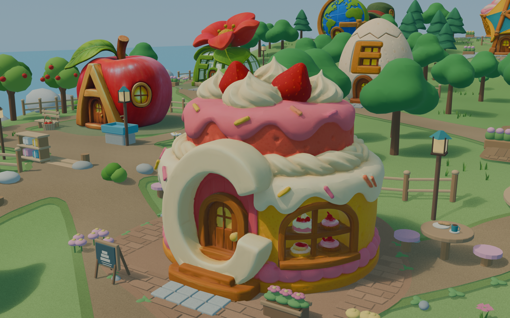

# 字母岛地图 · 第五版，材质统一与角色视角精修

2026-10-22。本版统一地标与环境的材质响应，重点细化家园、C 烘焙坊、O 图书馆及北侧学校。26 个地标、130 个记忆锚点、学校位置与路线保持不变。

## 当前交付

- [第五版 Blender 工程](alphabet_island_layout_v05.blend) · [第五版整岛 GLB](alphabet_island_layout_v05.glb)。
- [全岛总览](alphabet_island_overview_v05.png)，1920 × 1440。
- [地标与锚点清单](placement_manifest_v05.json) · [路线数据](route_graph_v05.json)。
- [材质和局部细化记录](character_polish_v05.json) · [检查机位配置](player_view_cameras_v05.json) · [场景检查](scene_validation_v05.json) · [GLB 导出检查](export_validation_v05.json)。

## 角色视角检查

七张近景均为 Blender 实际渲染，1600 × 1000。四个邻近第三人称机位用于观察入口、地标和周围道路；三个检查机位距站立处地面 1.35 米，用于查看儿童眼高下的门窗、台阶和遮挡。它们是静态美术检查机位，尚未接入角色或跟随相机。

| 地点 | 邻近第三人称视角 | 1.35 米眼高 |
|---|---|---|
| 家园 | [家园与门前广场](alphabet_island_player_home_v05.png) | [门窗与门廊](alphabet_island_eye_home_v05.png) |
| C 烘焙坊 | [建筑、入口与茶座](alphabet_island_player_bakery_v05.png) | [门洞、菜单与铺装](alphabet_island_eye_bakery_v05.png) |
| O 图书馆 | [入口与阅读角](alphabet_island_player_library_v05.png) | — |
| 学校 | [校门与教学楼](alphabet_island_player_school_v05.png) | [校门灯与入口](alphabet_island_eye_school_v05.png) |

## 本轮细化

26 个地标继续使用原有颜色贴图，调整工作副本的粗糙度、金属度、镜面反射与法线强度，减少自动生成材质中不一致的强反光。大多数地标粗糙度为 0.76，船屋、玻璃罐、机器人和鲸鱼保留适当差异；R 的少量金属感保留。原始 Tripo GLB 未改写。

环境采用木材、石材、泥土、灰泥等共享材质类别，添加四组 512 像素细微法线和四组颜色颗粒纹理，并保留地形、道路、瓦片的顶点色。纹理使用明确 UV，与材质参数一并导入 GLB。69 处旧灌木做了轮廓平滑，19 盏公共路灯补上灯框，四处近景道路边缘添加 48 组低矮三叶草和小石块。

| 区域 | 新增或调整 |
|---|---|
| 家园 | 暖色墙面、木框、蓝绿色玻璃、阁楼圆窗、窗台、门铰链与信口、门垫、雨靴、入口铺装 |
| C 烘焙坊 | 圆角门槛石、低花箱、蛋糕图形菜单、原有茶座上的杯碟与面包 |
| O 图书馆 | 带轮书车、独立书本、长椅上的书、门前石板与低花箱 |
| 学校 | 校门石板、灯框、公告栏图形与图钉、围栏柱脚 |

近景重点 C/O 的颜色与法线贴图从原始 4096 像素内嵌贴图重新提取为 2048 像素，文件保存在 [textures_v05](textures_v05/)。其余字母地标继续使用 1K 工作贴图；地标几何预算仍约为每处 5 万三角面。原始素材的 SHA-256 校验值均保持不变。

## 交付规格与检查边界

整岛 GLB 为 128,888,360 字节，约 128.9 MB；约 1,955,814 个实例三角面、4,169 个节点、145 个导出材质变体与 59 张内嵌图像。四张 C/O 重点贴图为 2K，其余图像不超过 1K。地标与记忆锚点、学校及其五个定位点的位置已和第四版逐项比较。

GLB 结构检查确认：26 个地标的新粗糙度、金属度与法线强度已保留，环境颗粒与法线图已内嵌，地形和道路的顶点色及 UV 已导出，隐藏旧几何未混入。Blender 中的柔和日光与天空渐变保存在工程中；GLB 不包含环境光照，接入引擎时需重新配置。

当前仍是静态室外素材。角色行走、碰撞、导航网格、自动遮挡处理、开门、室内及运行性能尚未验证；C 原模型背侧的浅浮雕残影未在本轮重拓扑。材质统一保留了各个地标原有的绘制内容，并未重绘全套原始颜色贴图。

## 继续编辑

以第五版 `.blend` 为主文件，默认打开烘焙坊近景机位；内部地图场景名仍为 `Alphabet_Island_Layout_v01`，`output_version` 为 `v05`。新细节位于 `ALPHA_Character_Polish_v05` 集合。七个检查机位名称以 `ALPHA_Camera_Player_` 或 `ALPHA_Camera_Eye_` 开头；渲染它们时使用 1600 × 1000，总览使用 1920 × 1440。

[character_polish_v05.py](character_polish_v05.py) 记录材质、近景道具、纹理及机位处理，依赖已有地图模块，按文件开头列出的阶段执行。它是制作记录，完整从空场景重建尚未验证；不要在已有 v05 细节上重复执行新增阶段。

[refresh_landmarks.py](refresh_landmarks.py) 用于接入改过的源模型。替换地标后需重新检查本版的材质配置、C/O 近景贴图及周围道具。[save_map.py](save_map.py) 按场景当前版本保存 `.blend` 与 GLB，同版本会覆盖，下一轮编辑先另存新版本。

## 历史版本与学校

[第四版说明](README_v04.md) · [第四版地图工程](alphabet_island_layout_v04.blend) · [第三版说明](README_v03.md) · [第二版说明](README_v02.md) · [第一版说明](README_v01.md)。

学校保持北侧高地的位置，距家园直线约 68.3 米，经 K、L 的规划路线约 99.6 米，另一路连接 M。[独立学校素材包 v01](../school/README.md)保留原版本；本轮校门和材质细化包含在整岛 v05 内。教材故事线继续暂缓。

## 地标位置

坐标单位为米，Blender Z 向上、建筑正面 -Y；GLB 按标准 Y 向上导出。

| 字母 | 地标 | 街区 | X | Y | 目标宽度 | 地图三角面 |
|---|---|---|---:|---:|---:|---:|
| A | 苹果果园屋 | 晨光村 | -50 | -23 | 6 | 49,999 |
| B | 船屋码头 | 晨光村 | -55 | -43 | 7 | 18,051 |
| C | 蛋糕烘焙坊 | 晨光村 | -33 | -34 | 7 | 50,000 |
| D | 鼓屋音乐厅 | 晨光村 | -24 | -17 | 6.5 | 49,999 |
| E | 蛋壳孵化屋 | 晨光村 | -39 | -6 | 6 | 49,999 |
| F | 巨花温室 | 晨光村 | -55 | -4 | 8 | 49,999 |
| G | 地球仪旅行馆 | 巧手街 | -52 | 19 | 7 | 49,998 |
| H | 帽子裁缝店 | 巧手街 | -54 | 39 | 7.5 | 49,999 |
| I | 冰淇淋驿亭 | 巧手街 | -36 | 44 | 5.8 | 49,999 |
| J | 玻璃罐收藏馆 | 巧手街 | -20 | 39 | 6.7 | 50,000 |
| K | 风筝工坊 | 巧手街 | -31 | 20 | 8 | 49,999 |
| L | 灯笼驿站 | 林间村 | -8 | 42 | 7 | 50,000 |
| M | 蘑菇邻居屋 | 林间村 | 13 | 44 | 8 | 49,999 |
| N | 鸟巢观察屋 | 林间村 | 33 | 38 | 7 | 50,000 |
| O | 猫头鹰图书馆 | 林间村 | 52 | 29 | 8 | 50,000 |
| P | 南瓜农场屋 | 林间村 | 28 | 21 | 7 | 49,998 |
| Q | 拼布故事馆 | 山丘学园 | 49 | 8 | 7 | 49,999 |
| R | 机器人工坊 | 山丘学园 | 58 | -8 | 7.5 | 50,000 |
| S | 星形天文台 | 山丘学园 | 39 | -14 | 9 | 49,998 |
| T | 火车车站 | 山丘学园 | 50 | -27 | 10 | 50,000 |
| U | 雨伞气象屋 | 山丘学园 | 35 | -36 | 8 | 49,999 |
| V | 休眠火山观察站 | 海湾远行区 | 16 | -38 | 9 | 50,000 |
| W | 鲸鱼海洋馆 | 海湾远行区 | 12 | -54 | 10 | 49,998 |
| X | 木琴海边舞台 | 海湾远行区 | -7 | -53 | 9 | 49,999 |
| Y | 毛线手作屋 | 海湾远行区 | -20 | -41 | 7 | 49,999 |
| Z | 斑马邮局 | 海湾远行区 | -33 | -50 | 8 | 50,000 |
