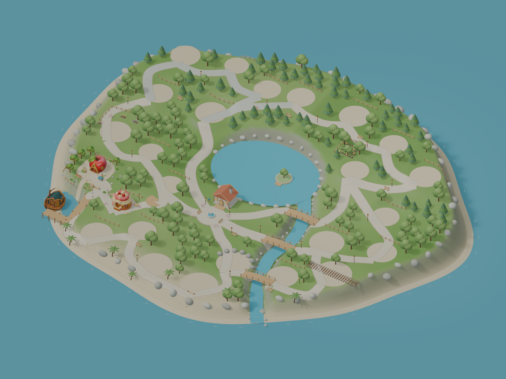

# 字母岛地图 · Blender 第一版

2026-10-21。当前已完成可编辑的三维地图布局：连续岛屿、五个街区、中央家园与湖泊、主路与捷径、三座跨河桥、码头、树林和基础花园。已接入 A 苹果屋、B 船屋、C 蛋糕烘焙坊；D—Z 的地块、定位点和记忆锚点已准备好，等待后续模型。



## 直接打开

- [Blender 地图工程](alphabet_island_layout_v01.blend)：继续编辑的主文件，活动场景为 `Alphabet_Island_Layout_v01`。
- [整岛 GLB](alphabet_island_layout_v01.glb)：用于后续引擎接入，保留地标定位点与记忆锚点。
- [全岛预览](alphabet_island_overview_v01.png) · [A—C 村落近景](alphabet_island_morning_village_v01.png) · [家园与湖泊近景](alphabet_island_home_lake_v01.png)。三张预览均为 Blender 实际渲染，1920 × 1440。
- [地标坐标与资产清单](placement_manifest.json) · [路线图数据](route_graph.json) · [场景检查](scene_validation.json) · [导出检查](export_validation.json)。

## 当前地图

| 区域 | 字母 | 位置与环境 |
|---|---|---|
| 晨光村 | A—F | 西南侧，果园、船屋码头、烘焙坊与花园 |
| 巧手街 | G—K | 西北侧，石色街道、工坊地块 |
| 林间村 | L—P | 北侧至东北侧，树林、农场与邻居屋地块 |
| 山丘学园 | Q—U | 东侧，山坡、观察点与车站预留地 |
| 海湾远行区 | V—Z | 南岸，海湾道路、沙地和海边舞台地块 |

设计占地约 150 × 130 米。A→B→…→Z→A 构成环线，家园有五条通往不同街区的捷径。主路宽约 3.1 米；路径已贴合实际地形，并为部分临水地块补充挡土边。火车站预留地已向内陆调整。

字母由各自的建筑表现，地图里没有额外放置字母牌。尚未到位的模型用空地表示，编辑定位框在渲染中隐藏。

每个地标有五个固定记忆锚点，共 130 个。A 果园沿用已有的篮子、苹果树、分拣台、水槽、礼物架；其他地标目前是命名的空间锚点，尚未全部制作对应道具或学习交互。

## 接入后续 Tripo 模型

将单个模型放在 `assets/tripo/`，文件名使用大写字母加下划线，例如 `D_drum_music_hall.glb`。同一字母存在多个 GLB 时，刷新脚本选择修改时间最新的一个；A 固定使用已经精简的苹果屋模型。不要同时存放同一字母的多个无关模型。

在 Blender 打开本地图工程后，可以通过 MCP 执行 [refresh_landmarks.py](refresh_landmarks.py)。它读取 GLB 的实际包围盒，按定位点设置的宽度等比例缩放，使底部贴到定位点；已导入且内容未变化的模型会跳过。脚本只替换该地标定位点下面的资产，不重建地形和道路，也不改写 Tripo 源文件。刷新不会自动保存工程或更新预览。

正面默认朝 Blender 的 `-Y`，上方为 `+Z`。如果新模型的正面不同，需要接入时人工校正朝向；自动缩放不能代替门口、台阶和道路的视觉检查。

在 Blender 的 Python 环境执行外部脚本时，应提供 `__file__`：

```python
from pathlib import Path
p = Path('/Users/xionglei/Documents/StudyGame/assets/blender/alphabet_island/refresh_landmarks.py')
exec(compile(p.read_text(), str(p), 'exec'), {'__name__': '__main__', '__file__': str(p)})
```

`ALPHA_LANDMARK_A_SOCKET` 至 `ALPHA_LANDMARK_Z_SOCKET` 是地标定位点；各点保存字母、英文词、街区、目标宽度、资产状态和源文件校验值。坐标详见清单。GLB 采用标准 Y 向上导出，导入引擎时应按 glTF 坐标约定处理，清单中的坐标仍为 Blender Z 向上。

## 制作文件与保存

[world_builder.py](world_builder.py) 包含地形、道路、地块、家园、植被和资产接入函数；[layout.json](layout.json) 保存布局参数；[refine_map.py](refine_map.py) 处理道路贴地、码头衔接、地台边和地形颜色。

[build_world.py](build_world.py) 是重新构建入口，应在没有同名地图场景的 Blender 文件中运行。它依赖项目里的 A 果园工程和 Tripo 源模型；发现同名地图场景会停止，避免重复构建。它不保存文件。当前交付是在实时 Blender 中分阶段构建和检查的；完整入口脚本已做语法检查，尚未在第二个空白 Blender 文件中重新跑完。

[save_map.py](save_map.py) 在地图模块已加载后检查结构并保存工程、GLB 和清单，会覆盖本目录同名 v01 输出；需要保留迭代历史时，先另存新版本。新增模型后还应重新渲染预览。已有 A 果园工程、B/C 审阅场景和 Tripo 源文件均已保留。

## 验证范围与下一阶段

已核对 26 个定位点、每处五个记忆锚点、家园与全部字母的路线图连通性、有限坐标、A/B/C 缩放尺寸、源文件校验值，以及 GLB 文件头、内嵌贴图和地形顶点色。检查了总览、A—C 近景与家园近景。GLB 排除了编辑定位框、相机灯光和展示用外海大平面。

当前 GLB 约 48.9 MB，包含 3,187 个节点、约 766,596 个实例三角面和 7 张内嵌贴图。这是场景原型，保留了 A 的大尺寸贴图和 C 的高细节模型，尚未完成整岛运行时减面、LOD 或材质合批。

尚未制作角色控制、碰撞体、寻路网格、开门/室内、NPC、学习任务和存档；路线图连通不等于已经通过角色行走测试。尚未在游戏引擎中验证性能。后续先接齐 D—Z 并逐个校正门口，再做碰撞与行走检查。

## 地标位置

单位：米，Blender 坐标；宽度为接入目标宽度。

| 字母 | 对象 | 街区 | X | Y | 宽度 | 状态 |
|---|---|---|---:|---:|---:|---|
| A | 苹果果园屋 | 晨光村 | -50 | -23 | 6 | 已接入 |
| B | 船屋码头 | 晨光村 | -55 | -43 | 7 | 已接入 |
| C | 蛋糕烘焙坊 | 晨光村 | -33 | -34 | 7 | 已接入 |
| D | 鼓屋音乐厅 | 晨光村 | -24 | -17 | 6.5 | 等待模型 |
| E | 蛋壳孵化屋 | 晨光村 | -39 | -6 | 6 | 等待模型 |
| F | 巨花温室 | 晨光村 | -55 | -4 | 8 | 等待模型 |
| G | 地球仪旅行馆 | 巧手街 | -52 | 19 | 7 | 等待模型 |
| H | 帽子裁缝店 | 巧手街 | -54 | 39 | 7.5 | 等待模型 |
| I | 冰淇淋驿亭 | 巧手街 | -36 | 44 | 5.8 | 等待模型 |
| J | 玻璃罐收藏馆 | 巧手街 | -20 | 39 | 6.7 | 等待模型 |
| K | 风筝工坊 | 巧手街 | -31 | 20 | 8 | 等待模型 |
| L | 灯笼驿站 | 林间村 | -8 | 42 | 7 | 等待模型 |
| M | 蘑菇邻居屋 | 林间村 | 13 | 44 | 8 | 等待模型 |
| N | 鸟巢观察屋 | 林间村 | 33 | 38 | 7 | 等待模型 |
| O | 猫头鹰图书馆 | 林间村 | 52 | 29 | 8 | 等待模型 |
| P | 南瓜农场屋 | 林间村 | 28 | 21 | 7 | 等待模型 |
| Q | 拼布故事馆 | 山丘学园 | 49 | 8 | 7 | 等待模型 |
| R | 机器人工坊 | 山丘学园 | 58 | -8 | 7.5 | 等待模型 |
| S | 星形天文台 | 山丘学园 | 39 | -14 | 9 | 等待模型 |
| T | 火车车站 | 山丘学园 | 50 | -27 | 10 | 等待模型 |
| U | 雨伞气象屋 | 山丘学园 | 35 | -36 | 8 | 等待模型 |
| V | 休眠火山观察站 | 海湾远行区 | 16 | -38 | 9 | 等待模型 |
| W | 鲸鱼海洋馆 | 海湾远行区 | 12 | -54 | 10 | 等待模型 |
| X | 木琴海边舞台 | 海湾远行区 | -7 | -53 | 9 | 等待模型 |
| Y | 毛线手作屋 | 海湾远行区 | -20 | -41 | 7 | 等待模型 |
| Z | 斑马邮局 | 海湾远行区 | -33 | -50 | 8 | 等待模型 |
