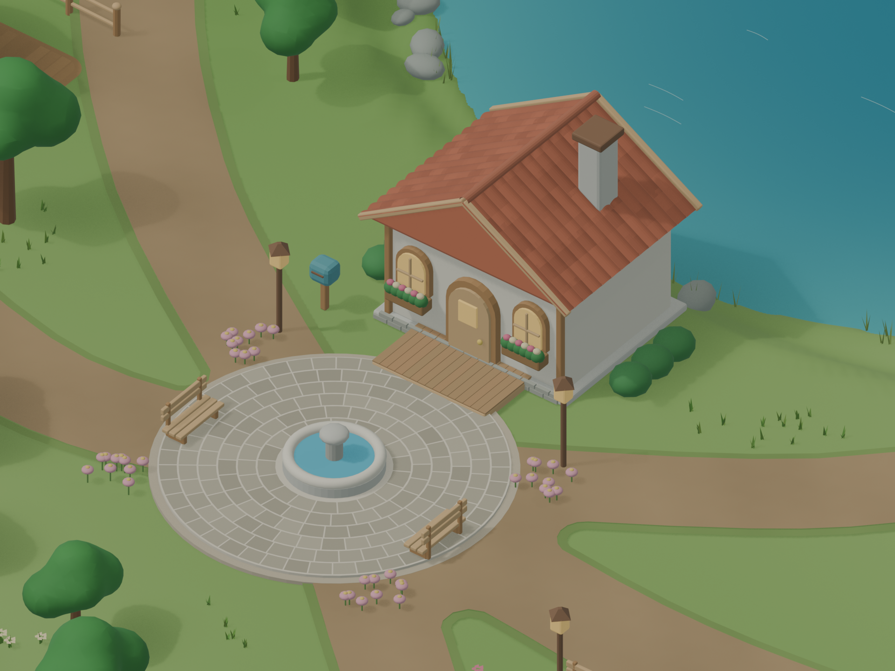

# 字母岛地图 · 第三版，第一轮美术细化

2026-10-21。针对第二版环境较粗糙的问题，细化道路、庭院、植被、水岸和家园。A—Z 全部 26 个地标、五个街区与 130 个记忆锚点沿用原位置；Tripo 源模型没有改写。

## 当前交付

- [Blender 第三版工程](alphabet_island_layout_v03.blend)：当前继续编辑的主文件。内部场景名沿用 `Alphabet_Island_Layout_v01`，场景属性 `output_version` 为 `v03`。
- [整岛 GLB 第三版](alphabet_island_layout_v03.glb)：地标、细化环境、定位点和记忆锚点。
- [全岛总览](alphabet_island_overview_v03.png) · [家园细节](alphabet_island_home_detail_v03.png) · [湖岸](alphabet_island_home_lake_v03.png) · [图书馆花园](alphabet_island_library_garden_v03.png)。
- 街区近景：[晨光村 A—F](alphabet_island_morning_village_v03.png) · [巧手街 G—K](alphabet_island_northwest_craft_v03.png) · [林间村 L—P](alphabet_island_forest_village_v03.png) · [山丘学园 Q—U](alphabet_island_eastern_academy_v03.png) · [海湾远行区 V—Z](alphabet_island_south_bay_v03.png)。
- [地标清单](placement_manifest_v03.json) · [路线数据](route_graph_v03.json) · [精修记录](polish_summary_v03.json) · [场景检查](scene_validation_v03.json) · [导出检查](export_validation_v03.json)。

九张预览均为 Blender 实际渲染，1920 × 1440。

## 这一轮修改

道路合并成连续路面，圆顺处理交汇处和门前连接，补草地过渡与局部路缘石。苹果果园的小路纳入同一套地面，并去除独立果园遗留下来的、伸向海湾陡坡的南侧残段；通往船屋的现有码头路线保留。

25 个陆上地标的庭院按用途区分砖、石材、木板、花园土与火山地面；共加入 2,319 块铺装细节。B 船屋继续使用木码头。E/F/M/N/O/P 入口补踏石和低矮开花灌木，保持门口及建筑字形可见。

替换 156 棵环境树的树冠，使用连续圆润的阔叶树冠和分层松树冠；补成簇草叶与野花。湖面加入深浅颜色、睡莲和水纹，湖边岩石改为疏密变化的石组，补芦苇。湖岸直接接入地形，避免在道路上叠加岸边色块；外海补浅水颜色过渡。

中央家园补弧形瓦片、屋脊瓦、木廊板、基础砌石、窗台花箱、矮灌木和喷泉周围的环形铺石。原有街区座椅、工作台、车站平台、种植区等继续保留。

新细节主要集中在 `ALPHA_Polish_v03`。被替代的旧道路、树冠、地台保留在工程中并隐藏，标记为 `superseded_by_v03`；GLB 排除这些旧几何。

## 资产与工作预算

地图继续使用第二版的地标工作副本：每个地标最多约 50,000 三角面，B 保持约 18,000 面；贴图上限 1024 × 1024，保留已有底色、法线和粗糙度/金属度贴图。26 个地标合计 1,268,031 三角面；更高精度的 Tripo 源文件均保留，SHA-256 检查未变。

整岛 GLB 约 134.4 MB，含 3,294 个节点、约 1,833,316 个实例三角面、91 个材质与 76 张内嵌贴图。细化使用几何和顶点色，地面、铺装与水色已经随 GLB 导出。当前仍是美术细化中的场景，没有做游戏引擎帧率测试。

## 编辑与模型更新

继续编辑优先打开交付的第三版 `.blend`。模型仍放在项目 `assets/tripo/`，支持 `D.glb` 或 `D_drum_music_hall.glb` 的命名；同一字母多个候选时选修改时间最新的文件，A 固定使用 `A_apple_house/A_apple_house_optimized_v02.glb`。

[refresh_landmarks.py](refresh_landmarks.py) 逐个核对源文件，跳过未变化模型；变化模型重新放入固定位置并应用地图预算。它不自动保存、不更新预览、不重新拟合 v03 庭院与踏石。模型轮廓变化后，应人工核对门口、院落和台阶关系。

[prepare_map_assets_v02.py](prepare_map_assets_v02.py) 负责地标减面和贴图预算；[detail_sites_v02.py](detail_sites_v02.py) 记录此前的入口与道具制作。

本轮新增 [plan_polish_v03.py](plan_polish_v03.py)、[polish_plan_v03.json](polish_plan_v03.json)、[polish_map_v03.py](polish_map_v03.py) 与 [果园旧路轮廓](orchard_path_footprints_v03.json)。平面规划使用 Shapely 2.1.2；Blender 脚本记录各细化阶段，依赖已经加载的地图模块与第二版场景。它们属于制作记录，尚未在全新进程中验证完整重建；不要在已精修工程上从头重复运行。

[save_map.py](save_map.py) 检查并保存场景当前版本的工程、GLB 与清单，会覆盖同版本文件；下一轮修改先另存新版本。基础构建脚本 [build_world.py](build_world.py) 仅用于最初的地图，不等于第三版的一键重建。

## 验证与下一步

已核对 26 个地标定位、130 个记忆锚点与第二版完全一致，地图逻辑路线连接家园和全部字母。坐标、模型尺寸、源文件校验、GLB 文件头、内嵌贴图、顶点色、旧几何排除均通过；逐区和近景渲染已检查。路线图连通不代表寻路网格已经可用。

本轮属于第一轮美术细化。后续仍应统一地标与环境的材质表现，细修海岸与局部坡面，并按实际角色视角检查遮挡。C 模型背侧原有浅浮雕残影尚未重塑。角色移动、碰撞、寻路、开门、室内、NPC、学习任务与存档仍未实现。

## 版本保留

[第二版工程](alphabet_island_layout_v02.blend) · [第二版 GLB](alphabet_island_layout_v02.glb) · [第二版说明](README_v02.md)。[第一版工程](alphabet_island_layout_v01.blend) · [第一版说明](README_v01.md)。A 果园独立工程和所有源模型保持原状。

## 地标位置

坐标单位为米，Blender Z 向上、建筑正面 -Y；GLB 按标准 Y 向上导出。

| 字母 | 地标 | 街区 | X | Y | 目标宽度 | 地图三角面 |
|---|---|---|---:|---:|---:|---:|
| A | 苹果果园屋 | 晨光村 | -50 | -23 | 6 | 49,999 |
| B | 船屋码头 | 晨光村 | -55 | -43 | 7 | 18,051 |
| C | 蛋糕烘焙坊 | 晨光村 | -33 | -34 | 7 | 50,000 |
| D | 鼓屋音乐厅 | 晨光村 | -24 | -17 | 6.5 | 49,999 |
| E | 蛋壳孵化屋 | 晨光村 | -39 | -6 | 6 | 49,999 |
| F | 巨花温室 | 晨光村 | -55 | -4 | 8 | 49,999 |
| G | 地球仪旅行馆 | 巧手街 | -52 | 19 | 7 | 49,998 |
| H | 帽子裁缝店 | 巧手街 | -54 | 39 | 7.5 | 49,999 |
| I | 冰淇淋驿亭 | 巧手街 | -36 | 44 | 5.8 | 49,999 |
| J | 玻璃罐收藏馆 | 巧手街 | -20 | 39 | 6.7 | 50,000 |
| K | 风筝工坊 | 巧手街 | -31 | 20 | 8 | 49,999 |
| L | 灯笼驿站 | 林间村 | -8 | 42 | 7 | 50,000 |
| M | 蘑菇邻居屋 | 林间村 | 13 | 44 | 8 | 49,999 |
| N | 鸟巢观察屋 | 林间村 | 33 | 38 | 7 | 50,000 |
| O | 猫头鹰图书馆 | 林间村 | 52 | 29 | 8 | 50,000 |
| P | 南瓜农场屋 | 林间村 | 28 | 21 | 7 | 49,998 |
| Q | 拼布故事馆 | 山丘学园 | 49 | 8 | 7 | 49,999 |
| R | 机器人工坊 | 山丘学园 | 58 | -8 | 7.5 | 50,000 |
| S | 星形天文台 | 山丘学园 | 39 | -14 | 9 | 49,998 |
| T | 火车车站 | 山丘学园 | 50 | -27 | 10 | 50,000 |
| U | 雨伞气象屋 | 山丘学园 | 35 | -36 | 8 | 49,999 |
| V | 休眠火山观察站 | 海湾远行区 | 16 | -38 | 9 | 50,000 |
| W | 鲸鱼海洋馆 | 海湾远行区 | 12 | -54 | 10 | 49,998 |
| X | 木琴海边舞台 | 海湾远行区 | -7 | -53 | 9 | 49,999 |
| Y | 毛线手作屋 | 海湾远行区 | -20 | -41 | 7 | 49,999 |
| Z | 斑马邮局 | 海湾远行区 | -33 | -50 | 8 | 50,000 |
