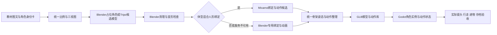

# 教材NPC、Mixamo与Tripo角色制作管线

日期：2026-10-22。状态：待实施的生产约定。适用于当前Godot 4.7 / GL Compatibility；没有提交任何线上生成或绑骨任务。

## 1. 先保留人物身份，再统一美术

首批角色必须覆盖[教材人物核对表](textbook_characters.json)中已核实的人物。记录教材中的英文名、代表页、可辨认外形、角色类型，画出适合当前游戏镜头的正侧背视图。教材中没有依据的姓名翻译、族裔、年龄和家庭关系不要自行补作事实。

将教材平面人物转为游戏3D时，保留发型、服装主色、体型或明显附件等辨认线索，调整为本项目圆润、简化、低光泽的材质。先由同一份比例图确定手臂长度、肩宽、头身和手脚大小，再批量做模型。不要用一套人形网格换衣服就假称所有特殊体型已处理。

角色分为人形、直立拟人动物、四足或其他特殊生物、只在故事中出现的演员。分类来自图像核对；名字相似或站立姿态不等于骨架适合Mixamo。

轮椅情境另设`wheelchair_humanoid_v1`。Jim在对应教材场景使用轮椅与坐姿接触：坐垫、脚踏、手臂、礼物和视线高度共同校正，不安排普通步行、站起或步行护送，也不从这一场景推断永久医学状态。将来剧情若需要轮椅移动，应另写移动动作、轮转与可达路线规格，不能用静态坐姿代替已经完成的移动能力。

## 2. 建议的主路径



Blender保存编辑源、网格、权重、材质、动作、附件与导出约定；Godot负责角色身份、行走导航、行为日程、动作状态、剧情时机与保存。修改Blender之后仍需导出、导入和检查，已经发布的游戏包也需重新构建。

当前`sync-blender-game.ps1`只导出主岛和场所模型，并同步字体与游戏构建；现有地图同步器不负责新NPC的骨架和动作库。实施时需增加独立的角色清单、导出、验证与同步步骤，再纳入统一构建。不能因为原有“更新Blender地图”成功，就宣称新角色动画已经进入游戏。

## 3. Mixamo适用范围与制作依赖

Adobe官方文档说明，自动绑定面向双足人形；极端比例、分离悬空的身体部件或大型额外附件可能失败。现有程序拼接的熊兔与主角不能直接当作已经合格的绑定源。先整理可变形网格、自然对称初始姿态与清楚的四肢，再提交样本。[Mixamo FAQ](https://helpx.adobe.com/creative-cloud/faq/mixamo-faq.html)

官方上传说明支持FBX、OBJ或打包素材，已绑定角色使用FBX。项目保留下载的绑定模型和每段动作来源，不能把网站上的最近角色当唯一备份。[Adobe上传与绑定说明](https://helpx.adobe.com/creative-cloud/help/mixamo-rigging-animation.html)

该FAQ还列有账号地区可用性限制，包括China country code。本轮没有检查用户账号可用性；将它作为正式生产前的依赖核验。若不可用，角色身份、动作规格与Godot接口不变，改走Blender绑定/已有合适授权动作，不让首批人物策划依赖一次网页登录成功。

## 4. 统一骨架与动作契约

| 项目 | 项目约定（拟定） | 验证方法 |
|---|---|---|
| 尺度 | 1个Godot单位对应1米；每角色高度由比例表确定，不把同学机械缩放成幼年成人 | 门、课桌、椅子与主角并排检查，附件接触点可达 |
| 坐标 | 游戏角色Y向上，视觉正面为+Z，脚底接地中心作为角色原点；Blender导出坐标转换只做一次 | 四方向行走、转身、正面递物，无180度反转 |
| 人形基础 | 一个版本化人形骨架语义规范，可有儿童/成人等比例配置；数量由样板测试决定 | 头/肩/肘/腕/胯/膝/脚映射与初始姿态一致 |
| 额外部位 | 耳朵、尾巴、裙摆、长发为扩展骨骼或附属动画，不能覆盖核心人形动作 | 核心动作重定向后附件仍受正确控制 |
| 网格与权重 | 肩胯肘膝有足够变形结构，检查衣物穿插、孤立顶点与错误权重 | 抬臂、蹲下、坐姿、递物的最不利姿态近景与实际镜头都检查 |
| 移动 | 首轮使用原地行走片段；游戏角色控制器负责真实移动 | 直行、停步、斜坡、转弯，脚步频率与速度匹配 |
| 剧情动作 | 需要位移的表演独立声明，不同时让骨骼根运动和控制器重复移动 | 动作起点/终点可恢复，碰撞不穿墙 |
| 手持物 | 左右手/背部/头部等语义挂点；道具独立资源 | 书、名牌、篮子、球等实际对齐，不只看空手动作 |
| 表情 | 首批采用少量清楚表情与眨眼；表情资源与语音时长解耦 | 循环不僵硬，暂停和降低动态不会卡成错误表情 |
| 动作库 | 稳定语义ID，原文件名称单独记录，长度/循环/接触事件逐条填写 | 模型替换后同一动作命令仍能触发正确动作 |

Godot官方明确，动作复用不仅要匹配骨名，还要考虑骨骼初始变换。导入时使用`BoneMap`与适当的骨架配置进行重定向，检查引用姿态与轨迹；同名骨骼不是无缝替换的证明。[Godot骨架重定向](https://docs.godotengine.org/en/stable/tutorials/assets_pipeline/retargeting_3d_skeletons.html)

## 5. 角色实例与动画控制边界

以下是接口规划，节点和字段尚未加入游戏：

```text
NPCActor（稳定character_id、任务与日程身份）
├─ CharacterBody3D / 简化碰撞 / 导航控制
├─ VisualRoot（可以整体换成下一版模型）
│  ├─ Skeleton3D与蒙皮网格
│  ├─ AnimationPlayer（动画资源）
│  └─ AnimationTree（动作状态和混合）
├─ InteractionAnchor / NameLabel / MeetingAnchor
└─ PropSockets（手持物语义挂点的适配）
```

- 日程决定“去哪里、做什么”；动画状态机决定“如何表现”，动画片段不直接发放奖励。
- `walk_in_place`、`greet_wave`、`point_target`、`give_item`等由行为层调用，名称与动作清单保持一致。无某动作时使用清楚的降级表达，并记录缺项，不能静默当作验收通过。
- 递物的接触时刻发送`handoff_ready`等语义事件，任务层用唯一事件凭据处理道具转移；被打断、重播、恢复不能重复给物品或奖励。
- 对话时停在安全位置，面向交互对象；姓名、交互半径、碰撞跟随演员移动。以移动角色实体作为即时目标，不能继续查询旧静态点。
- NPC日程不等于不断完整寻路。当前场景近处完整更新，远处降频，离开场景仅保留逻辑位置和待办状态。具体频率与可见数量待设备测试。
- 当`AnimationTree`驱动动画时，不再让旧程序手臂摆动或`AnimationPlayer.play()`竞争同一变换轨迹。迁移期保留程序角色后备路径，按角色切换。
- 每次选片段同时满足“角色允许的活动、角色所需动作清单、骨架兼容表、能力约束”。通用`escort`需具备移动能力，不能因列表里存在坐姿待机就认为轮椅角色具备护送动作。四足等9类特殊骨架的最低待机/安全等待已由18项静态pose规格承接；`behavior_clip_bindings`必须解析到本骨架的`pose_spec_id`或兼容片段。定格只作最低可读表现，不计动画验收通过；26份P3工单仍要求完成对应章节必要动作与验收。
- 记忆舞台使用[mnemonic_story_assets.json](mnemonic_story_assets.json)的字母缩景和符号资源。它们是故事道具实例，不是教材NPC身份，R的机器人缩景不能自动等同Robbie，O的猫头鹰缩景也不注册成教材鸟类角色。

## 6. Tripo后续替换流程

Tripo作为模型候选生产来源，角色身份、比例、教材辨认线索和动作规格不随生成结果改变。其官方接口提供绑定适配检查，以及人形绑定输出与`mixamo`命名选项；这些能力不自动证明本项目角色肩胯比例、初始姿态、权重或动作兼容。[适配检查](https://developers.tripo3d.com/en/docs/animations-rig-check)、[绑定接口](https://developers.tripo3d.com/en/docs/animations-rig)

1. 固定教材参考页、角色卡和三视图，记录生成输入、服务/模型版本与输出日期；此时不用替换生产角色。
2. 保留原始输出只读副本，在新的Blender版本中处理拓扑、材质、贴图、尺度、附件和关节结构。
3. 选择项目人形规范或特殊体型骨架，重新绑定/重定向并修正权重。已带骨架的Tripo模型也必须通过同一动作检查。
4. 用相同`character_id`导入候选外观版本。只替换资源引用与必要挂点适配，保留存档、剧情、日程与会面点。
5. 完成待机、移动、挥手、递物、坐读以及该角色专有动作；在相同机位检查风格、体积、脚底和阴影。
6. 通过后更新角色资源映射；保留原版本可回退。不得只用新生成的GLB覆盖旧文件就认定完成替换。

Tripo可作备选绑定工具，但本轮不锁定付费方案、接口调用或账户资源。正式制作使用时再记录实际可用功能与素材来源条款。

## 7. 每个角色应交付的文件与清单

拟定目录：`assets/characters/<character_id>/source/`、`rig/`、`animations/`、`exports/`、`review/`。这些目录目前只是计划，不代表文件已经存在。

| 内容 | 必须记录 |
|---|---|
| 身份与参考 | 角色ID、教材名字、来源页与图片、物种、不可丢失的辨认线索 |
| 网格与材质 | 可编辑.blend、源输出、贴图、尺度、面数、材质槽、LOD与文件指纹 |
| 骨架 | rig_id与版本、骨骼映射、初始姿态、附件骨骼、手持挂点 |
| 动画 | clip_id、原始来源、重定向后文件、循环/长度、位移方式、语义事件、已测角色 |
| 来源记录 | 自制/Tripo/Mixamo/其他来源、生成或下载记录、适用条款、所需署名 |
| 验收 | 实际镜头截图与录像、变形/接触检查、性能记录、替换/恢复检查、问题与复核人 |

资源预算先作为试制目标：主要角色优先减少材质数与透明层，贴图按实际屏幕覆盖选尺寸；背景角色共享资源并使用简化外观。面数、纹理与同时可见数量在样板实测后确定，不将一个通用数字当作所有设备的性能保证。

同步检查至少包括：角色ID和外观版本唯一、引用文件存在、GLB含预期skin及动作、关键骨骼与挂点完整、帧范围/循环和原地位移符合清单、来源和导出文件指纹可追踪。导入后再检查Godot的骨骼映射与实际播放，避免只验证GLB文件存在。程序占位模型与新蒙皮模型必须明确区分，缺少skin的候选不能被标为已完成绑骨。

## 8. 正式制作前的首个样板

P1同时保留四类样板：已核实教材主角中的一个人形、熊叔或兔兔一个拟人动物、Dino专用骨架、Jim场景的轮椅坐姿与上肢接触。人形测试标准动作；动物测试短肢体、大头、耳朵与服装；Dino测试翼尾与递物；轮椅样板测试坐姿、脚踏、礼物接触和视线，不套普通步行。四类结果分别记录，不能用人形样本通过代替特殊情境通过。

可步行角色的最小演出：从会面点走向玩家 → 停步转身 → 招手 → 说一句与教材身份一致的介绍 → 递出名牌 → 回到日常动作。轮椅样板使用对应原场景的坐姿交流和礼物交接。重复、中断、重进场景和模型替换后都应正确。P2接通完整26字母序章和U1；全部首批教材身份按八册章节在P3补齐，不要求142条来源身份的全部模型先于U1完成。
