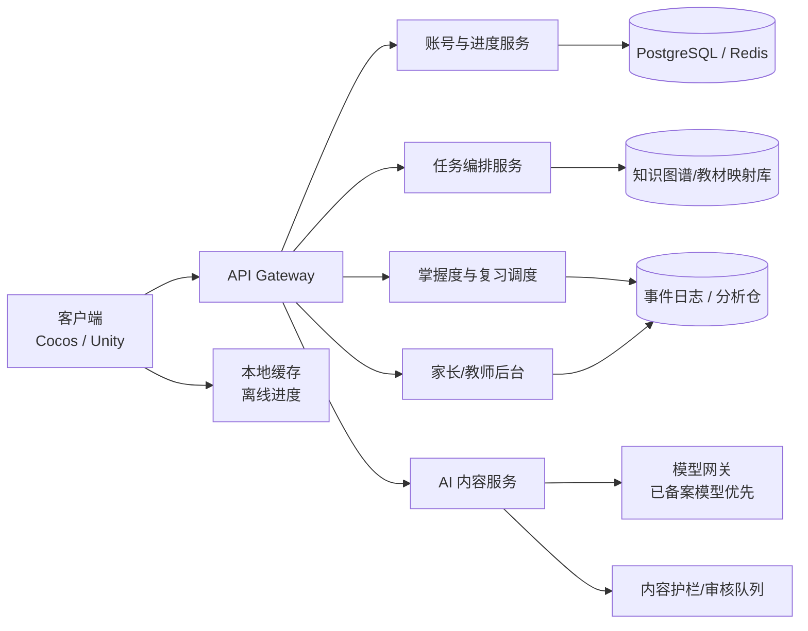
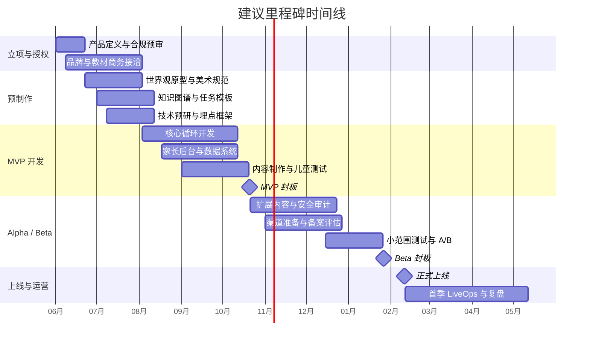

# 面向7–12岁小学生的芭比主题养成类 AI 游戏完整开发方案

## 执行摘要

这个项目**可行**，但前提不是“做一款长得像芭比的学习 App”，而是把它当成一个同时涉及 **教育内容设计、儿童产品设计、IP 授权、数据与 AI 安全、发行合规** 的复合型项目来做。教育层面，义务教育课程方案和 2022 版课程标准已经明确了小学阶段课程结构、核心素养导向与场景化学习方向；研究层面，游戏化/游戏式学习对儿童的认知、动机和参与度总体具有正向效果；政策层面，教育应用、未成年人网络保护、网络游戏、防沉迷、生成式 AI 与深度合成均有明确规则。换言之，这个想法不是“不能做”，而是**必须先定义清楚产品形态，再进入开发**。citeturn3view1turn33view1turn24view0turn21view1turn21view3

如果目标市场首先是中国大陆，最优路线**不是直接立项为重联网正式网络游戏**。原因很现实：若按网络游戏运营，要面对出版审批、著作权材料、实名、防沉迷、未成年付费限制等要求；若进入学校/教育移动应用场景，又要面对备案、内容审核、信息安全检测，以及“统一教学工具不得植入商业广告和游戏”的要求。对一个还未验证核心体验的新项目来说，最容易被卡住的不是“做不出 AI”，而是“产品被归入了错误的监管类别”。因此，本报告建议 **MVP 先做成移动端教育互动应用或轻联网养成产品**，弱化社交、抽卡、交易、公会、长时在线等典型网络游戏特征，同时将 Barbie 授权和教材授权作为并行商务线推进。citeturn35view3turn35view4turn21view1turn1search10turn24view0

从方法论上，最佳产品公式不是“把课本题目塞进剧情”，而是把四个机制连成闭环：**世界地图 = 记忆宫殿；任务行为 = 知识调用；行为日志 = 隐性测评；回访场景 = 间隔提取**。方法定位法（memory palace / method of loci）本质上依赖熟悉空间中的位置绑定；检索练习与间隔学习能增强长期保留；隐性测评则能把“学习与评估”嵌进游戏行为中，降低孩子对“又在上课/又要考试”的抗拒。对于 7–12 岁用户，这比显性刷题、闯关出卷、课本页码同步提示更符合持续留存逻辑。citeturn34search5turn34search0turn13search5turn10view2turn10view1

本报告的总建议可以浓缩为一句话：**先用原创“时尚娃娃风”MVP 验证孩子愿不愿意玩、知识能不能留、家长会不会买单；再决定是否升级为正式 Barbie 授权版与多教材版权合作版。** 这条路线既符合品牌与教材版权现实，也符合 2026 年以来“人工智能+教育”强调的“应用导向、智能向善、安全可控、场景式育人”方向。用户当前上传的技术草案已经覆盖了 Web 前端、RAG、多代理内容生成、家长中台、IRT/间隔重复等关键构件，说明前期思路并非从零起步，而是已具备沉淀为正式预制作文档的基础。citeturn29view2turn0file0

## 项目定位与关键假设

### 项目概述

本项目面向 **7–12 岁小学生**，对应中国义务教育小学阶段。教育内容上，建议优先围绕**语文、数学、英语**构建第一期内容包，把**科学**放入第二期扩展。这样做不是因为科学不重要，而是因为语文、数学、英语与养成类玩法的映射效率最高：语文适合做剧情、委托、阅读线索与表达；数学适合做搭配、建造、烘焙、种植中的数量、测量、时间、空间关系；英语课程内容在课标中按 3–4 年级一级、5–6 年级二级分层，天然适合做 NPC 日常交流、服饰与物品词汇、场景化口语；科学在小学一至六年级开设，适合通过观察、分类、种植、实验型任务做扩展。与此同时，语文课标强调学习任务群，数学课标强调数感、量感、符号意识、运算能力、空间观念等，小学英语强调围绕主题意义开展“学习理解—应用实践—迁移创新”活动，这些都比传统“题库驱动”更适合转译为养成类游戏任务。citeturn3view1turn31search3turn31search11turn7search2turn7search3turn8search5turn7search13

从卖点上看，这个项目最强的差异化不在“AI 陪聊”，而在于三层价值叠加。第一层是**女孩向陪伴式成长体验**：家园、装扮、宠物、邻里、舞台、收集与情感叙事。第二层是**隐性学习**：孩子感受到的是“我在帮助角色、布置房间、养花养宠、准备活动”，而不是“我在被要求背知识”。第三层是**可量化留存与学习成效**：家长端和教师端看到的不是孩子做了几道题，而是知识点是否在场景中被成功调用、隔天/隔周是否还能想起、哪些位置锚点最稳、哪些内容需要重返场景。2026 年《“人工智能+教育”行动计划》明确提出，要发展主题式学习场景、项目式与场景式育人、虚实融合学习空间，并以学生为中心配置学习资源，这为“养成游戏 + 学习场景 + 个性化陪伴”的产品思路提供了较强政策顺风。citeturn29view2

### 核心卖点

建议把核心卖点对外统一表述为：

| 维度 | 对孩子的感受 | 对家长/教师的价值 |
|---|---|---|
| 审美与情感 | 像在玩一个粉色、温暖、时尚、可照料的成长世界 | 女孩向产品稀缺，家庭接受度高 |
| 学习方式 | 不像上课，不像做题，更像完成生活任务 | 能“潜移默化”植入课本知识 |
| 记忆机制 | 地点、角色、物品和剧情帮助记住内容 | 可持续追踪记忆保持率 |
| AI 价值 | 角色更会回应、剧情更灵活、内容更个性化 | 可做分层推荐、自动生成内容包、家长报告 |

这些卖点与当前教育数字化、人工智能赋能教育的发展方向并不冲突，但需要建立在**安全可控、低侵扰、强审校**的工程体系上，而不能把开放式大模型直接交给儿童端。citeturn29view1turn29view2turn21view3

### 关键假设

以下为本报告默认假设，便于开发团队落地执行：

| 假设项 | 默认值 |
|---|---|
| 首发市场 | 中国大陆 |
| 目标终端 | iOS / Android，保留 H5/小游戏试玩入口 |
| 网络形态 | 弱联网，核心养成与记忆回访可离线进行 |
| 付费对象 | 家长，不面向儿童做高刺激内购 |
| 社交策略 | MVP 不开放儿童间自由聊天、陌生人社交、UGC 广场 |
| 品牌状态 | 暂无正式 Barbie 授权，先以“时尚娃娃风”原创占位 |
| 教材版权状态 | 暂无出版社数字改编授权，先做“按课标对齐、自主撰写表达”的内容包 |
| 内容优先级 | 语文 > 数学 > 英语 > 科学 |
| 单次时长 | 10–15 分钟为主，避免长时连续在线 |
| 预算单位 | 人民币 |

## 教学内容与版权授权方案

### 教学内容范围与优先学科

建议第一期不要贪大求全，而是围绕“最适合被游戏行为承载”的知识类型做内容范围控制：

| 学科 | 建议优先级 | 适合先做的内容 | 为什么适合养成游戏 |
|---|---|---|---|
| 语文 | 最高 | 识字词、近反义、句式、阅读线索、复述与表达、古诗词意象 | 最容易嵌入剧情、委托、对话、相册与物品叙事 |
| 数学 | 最高 | 数量关系、加减乘除、时间、长度重量容量、分类、图形与空间 | 最容易被“生活任务化” |
| 英语 | 高 | 颜色、服饰、家具、日常动作、问候、位置与简单描述 | 最能自然地做进 NPC 互动与物品收集 |
| 科学 | 中 | 观察记录、分类、植物生长、天气与材料特性 | 适合种植/养宠/实验扩展，但反馈系统更复杂 |

上表的排序依据主要来自课标与课程设置逻辑：小学英语从三年级起开设，科学在一至六年级开设；语文课标强调学习任务群，数学课标强调核心素养中的数感、量感、符号意识、空间观念等，小学英语强调围绕主题意义组织活动与迁移。换言之，**不应直接按教材页码做游戏，而应按“课标目标—场景行为—记忆锚点”倒推内容颗粒度**。citeturn3view1turn31search3turn31search11turn7search2turn7search3turn8search5

### 课本来源、拆解方法与授权需求

必须明确一个现实问题：**课标不是教材，教材也不是公有资源。** 《中小学教材管理办法》明确了教材送审、审核、目录发布与修改限制；国家版权局相关公开案例也明确指出，教科书具有著作权，虽然其编写受课程标准和教学大纲指导，但教材的具体内容和体系结构仍具有独创性，未经许可不得擅自使用。对商业化产品而言，这意味着你不能简单“把课本喂给 AI，再把生成内容上架”。citeturn35view0turn35view1turn35view2

因此，内容来源建议分成三条路线并行推进：

| 路线 | 做法 | 优点 | 风险 | 建议优先级 |
|---|---|---|---|---|
| 课标对齐自研 | 依据课标提炼知识点，所有文本、题干、插图、叙事均自行创作 | 版权最稳，迭代最快 | 不能直接声称“原版同步教材全文” | 最高 |
| 出版社/版权方授权 | 与人教社、外研社、地方版出版社等谈数字改编、选段使用、题目改写授权 | 市场说服力强，可做“地区版本包” | 商务周期长，授权费用与审批复杂 | 高 |
| 学校/区域合作内容 | 与学校、教研机构共创“课标对齐内容包” | 易进校，便于试点 | 复用性弱，品牌化慢 | 中 |

对开发团队最可执行的方式，是先建立一个**内容拆解流水线**：

| 层级 | 产物 | 负责人 | 说明 |
|---|---|---|---|
| 课程层 | 学科—年级—学期地图 | 教研负责人 | 定义学期内容范围与优先级 |
| 单元层 | 单元目标、能力标签与用户提供语料 | 学科策划 + 教研 | 语料来源和覆盖状态可追踪 |
| 原子层 | 知识原子卡 | 教研编辑 | 每张卡只承载一个最小能力单元 |
| 游戏层 | 行为任务模板 | 系统策划 | 把知识点转为任务、物品、地点、角色关系 |
| 记忆层 | 位置锚点卡 | 关卡策划 | 指定该知识点要绑定去哪一个场景位置 |
| 评估层 | 证据规则 | 数据策划 | 玩家什么行为代表“会了”“半会”“忘了” |
| 运营层 | 内容包与版本表 | 制片/运营 | 哪个地区、哪个教材版本、哪个学段可投放 |

这种拆解方式比“先拿课本全文做内容，再硬塞进世界观”稳定得多，也更符合隐性学习和隐性测评的设计逻辑。citeturn10view1turn10view2

### Barbie 授权策略与注意事项

如果你要使用 **“Barbie / 芭比”名称、人物形象、视觉资产、品牌语言、世界设定或近似可识别的官方角色体系**，就不能只做“灵感借鉴”，而必须进入正式授权流程。Mattel 官方明确显示，Barbie 属于其品牌组合；其官网内容、商标、图形、素材与相关知识产权由 Mattel、其许可方或第三方权利人拥有，未经授权的商业使用受到限制。与此同时，Mattel 仍在持续推进 Barbie 数字游戏和品牌合作，这说明“Barbie + 数字游戏”方向本身成立，但也意味着品牌审批会覆盖美术、叙事、文案、营销、包装乃至上线节奏。citeturn26search17turn30view3turn26search20turn26search4

因此最稳妥的做法不是“先做了再去谈授权”，而是**双轨推进**：

| 轨道 | 目标 | 产出 |
|---|---|---|
| 原创占位轨 | 先验证玩法与教学闭环 | 一套“时尚娃娃风”原创角色、原创家园、原创小镇、原创服装系统 |
| 品牌授权轨 | 与 Mattel/代理方谈品牌数字游戏授权 | 品牌使用范围、地区、年限、审核节点、素材交付、联名边界 |

这会直接影响美术与音频流程。只要 Barbie 授权未落地，团队就**不要在生产资产中使用官方 Logo、角色脸型、发型、服装标识或 Dreamhouse 等高识别元素**；否则前期资产会大面积返工，甚至无法商用。citeturn30view3turn26search3turn26search20

## 游戏设计方案

### 世界观与记忆宫殿映射规则

推荐的世界观不是“校园里做作业”，而是一个**时尚、温暖、可照料、可改造的小镇生活世界**。孩子进入的不是“学习系统”，而是一个可以升级家园、装扮角色、照顾宠物、参加活动、帮助邻居的小镇。真正的知识植入不以“学科入口”呈现，而以“地点功能”呈现：衣帽间负责服饰词汇和分类，厨房负责分量与时间，花园负责观察与科学，邮局/书房负责阅读线索，舞台负责节奏与表达。这样做的依据，是方法定位法本身就依赖“熟悉路线或房间中的明确位置”来绑定信息；而虚拟 memoryscape 的研究也表明，基于空间导航的环境可以承载记忆支持。与此同时，检索练习与间隔学习研究提示：同一知识点不需要“多做题”，而应在不同时间点**重返相同或相邻位置**进行再调用。citeturn34search5turn34search0turn10view2

建议采用如下映射规则：

| 场景 | 主承载内容 | 位置锚点设计 | 回访方式 |
|---|---|---|---|
| 衣帽间 | 英语/语文描述词、分类 | 衣架、镜子、鞋柜、首饰台 | 换装委托、找回遗失配件 |
| 厨房 | 数学中的容量、分数、时间顺序 | 量杯、烤箱、计时器、食谱夹 | 烘焙订单、派对准备 |
| 花园/温室 | 科学观察、分类、生命周期 | 花盆、喷壶、温度牌、虫盒 | 照料植物、季节任务 |
| 书房/邮局 | 阅读理解、线索提取、口语复述 | 书架、信箱、地图、日记本 | 收集线索、送信找人 |
| 客厅/建造区 | 几何、空间与组合 | 地砖、沙发位、窗帘、灯具 | 家居改造、摆放挑战 |
| 舞台/工作室 | 节奏、表达、复述、展示 | 麦克风、走位点、脚灯、台词卡 | 排练、演出、复盘 |

这套规则的关键不在“华丽”，而在**稳定**。记忆宫殿对儿童尤其要避免“一次性场景”和“会变形的房间”。你可以装修、升级、换皮肤，但核心锚点的位置最好保持稳定，否则会破坏位置记忆。对于低年龄段（7–8 岁），每次只引入 3–5 个新锚点更稳；对高年龄段（9–12 岁）才逐步扩到更长路线。年轻群体的意象记忆训练与空间能力提升研究，也提示空间化、图像化训练可以带来记忆及相关能力收益。citeturn13search5turn13search3turn34search5

### 隐性植入策略

用户已经非常明确地指出一个关键产品判断：**学习不应该太明显，否则孩子会产生抗性。** 这与隐性测评、游戏式学习研究是吻合的。隐性测评之所以重要，不是为了“偷偷考孩子”，而是为了让系统通过行为数据推断掌握情况，而不是不断弹出题目。相关研究指出，隐性测评可以把评估嵌入数字环境，持续采集行为数据，提供实时支持与自适应反馈，并降低传统测试引发的焦虑。citeturn10view1

具体落地时，建议把“学习”分成四层：

| 层次 | 儿童端感知 | 系统真实目的 |
|---|---|---|
| 感知层 | 我在帮助角色/装修/照顾/准备活动 | 建立任务动机与情感投入 |
| 行为层 | 我需要看懂、比较、分类、安排顺序 | 调动知识点使用 |
| 记忆层 | 我记得这个东西好像在那个房间/那个架子 | 建立位置-内容链接 |
| 评估层 | 我没有被考试 | 系统通过日志判断掌握度并安排复习 |

如果你在儿童端频繁出现“同步三年级上册”“今天背第几课”“正确率百分之几”，这个产品就会迅速滑回“刷题器”。反过来，如果孩子只是为了给角色准备生日派对、完成服装走秀、救活花园、找到邻居遗失的信，却在过程中自然调用词汇、时间、数量、阅读线索和方位关系，那么学习才是真正被“植入”了。研究综述也显示，游戏式学习对认知、情绪、动机和参与总体有正向影响，但效果依赖于游戏类型、学习目标和反馈方式；也就是说，**不是所有“加积分、领奖章”的伪游戏化都有效**。citeturn33view1

### 具体玩法示例

下面给出一组可直接进入原型制作的玩法模板。每个玩法都遵循同一个原则：**外显目标是生活化/审美化，隐性目标是知识调用与记忆巩固**。

| 玩法名称 | 外显目标 | 隐性学习内容 | 记忆宫殿位置 | 隐性测评信号 |
|---|---|---|---|---|
| 衣橱搭配委托 | 帮 NPC 挑选活动服装 | 分类、比较、颜色/材质词汇、英语服饰词 | 衣帽间 | 选择顺序、纠错次数、描述词调用 |
| 甜品工坊 | 为派对做点心 | 分数、容量、计时、步骤排序 | 厨房 | 配方是否独立完成、是否能根据失败调整 |
| 花园拯救计划 | 让花园恢复生机 | 植物生长、天气观察、分类、记录 | 温室/花园 | 是否能根据环境变化选择正确操作 |
| 邻里送信任务 | 找到正确收信人并送到 | 阅读线索、关键信息提取、地标识别 | 邮局/街区 | 是否能从对话中抽取有效线索 |
| 家居改造 | 布置房间让功能更合理 | 几何、对称、空间关系、面积感 | 客厅/卧室 | 摆放路径、试错模式、完成时间 |
| 宠物护理站 | 照顾小宠物恢复状态 | 观察、判断、顺序执行、简单科学常识 | 诊疗角 | 是否能区分症状与需求 |
| 星光舞台排练 | 准备演出或朗诵秀 | 节奏、停顿、句式、口头复述 | 舞台 | 重述完整度、停顿位置、二次表现 |
| 旅行相册 | 为小镇活动做纪念册 | 叙事顺序、图片描述、短句写作 | 相册馆 | 是否能按时间/逻辑排序并生成说明 |

这些玩法的共同特征是：孩子会更关注“角色成长”和“世界变好”，而不是知识本身；但知识点又必须真实地决定任务成败。这就是潜移默化能够成立的前提。为了进一步提高留存，建议每个玩法都让**知识调用带来世界变化**，例如花长出来了、房间更漂亮了、宠物开心了、派对开成了。这样知识不再是“额外负担”，而是**实现审美与情感目标的工具**。citeturn33view1turn10view1

## 系统架构与技术栈

### 推荐系统架构

在工程上，建议采用“**客户端轻逻辑 + 服务端内容编排 + AI 只在服务端运行 + 人工审校入库**”的架构。儿童端不应该直接面对开放大模型，也不应该在设备侧长期保存完整教材原文、敏感画像或未审校生成内容。更稳的做法是：客户端只呈现经过审核的任务、对话和场景；服务端负责任务编排、掌握度推断、复习调度、内容下发；AI 主要参与 **内容生产辅助、文本改写、剧情变体、难度分层、家长报告生成**，而不是直接“自由发挥讲课”。这也与当前生成式 AI 和深度合成监管框架中对内容安全、个人信息保护、日志留存和显著标识的要求更加一致。citeturn21view3turn22view0turn22view1

这一架构非常适合把“记忆宫殿 + 隐性测评 + 间隔提取”做成闭环：  
客户端负责世界体验，任务编排服务负责“今天让孩子去哪一个地点、触发哪一类剧情”，掌握度服务根据历史行为判断“是该复习、升级还是换一种提示”，家长后台只展示经过聚合后的学习与记忆指标，不暴露过度细碎的儿童行为原始数据。你上传的参考文本中已经预设了 RAG、多代理生成、IRT/间隔重复、家长中台等方向，这与正式版架构高度一致；区别只是，正式项目需要把它从“技术想法”提升为“可审计、可上线、可合规”的平台化工程。citeturn10view1turn0file0

### 技术栈建议

建议把技术栈分成“主路径”和“备选路径”，避免在早期陷入引擎宗教争论。

| 层级 | 推荐主路径 | 备选路径 | 说明 |
|---|---|---|---|
| 游戏客户端 | **Cocos Creator 3.8** | Unity 6.3 LTS | Cocos 对 H5、原生、微信/抖音/OPPO/vivo 等小游戏与多平台发布支持更强；Unity 更适合高质量 3D 正式版 |
| Web 试玩与家长端 | Next.js / React | Vue / Nuxt | 便于内容站、活动页、家长报表与后台快速迭代 |
| 后端 API | NestJS 或 Go | Java / Spring Boot | 团队若偏前端全栈，NestJS 效率更高 |
| 主数据库 | PostgreSQL | MySQL | 结构化数据、任务配置、账号进度 |
| 缓存 / 队列 | Redis | Kafka（规模上来后） | 进度缓存、异步任务、限流 |
| 行为分析 | ClickHouse / BigQuery 类数据仓 | 自建数仓 | 用于埋点分析、掌握度与留存 |
| 对象存储/CDN | 阿里云 OSS + CDN | 腾讯云 COS | 素材包、热更新资源 |
| AI 模型接入 | **阿里云百炼 / 千问** | 其他已备案模型网关 | 百炼支持 OpenAI 兼容接口，便于成本与技术迁移控制 |
| 国际版游戏后端 | PlayFab | 自建 + 云服务 | 如果未来上 Steam/主机，可考虑 PlayFab 的游戏后端与 LiveOps 能力 |

选择依据并非拍脑袋。Cocos 官方文档明确支持 iOS、Android、HarmonyOS、Windows、macOS、Web 以及微信、抖音、OPPO、vivo、荣耀等小游戏平台，适合中国市场移动优先与多入口分发；Unity 官方将 6.3 LTS 定位为适合 live service 和正式生产锁版的长期支持版本。阿里云百炼提供 OpenAI 兼容接口与多模态模型选择，适合作为国内公开服务时的合规主路径；微软 PlayFab 则明确提供游戏后端、实时分析与 LiveOps 能力，更适合国际版或强运营版。citeturn37view0turn36view4turn36view0turn36view1turn36view3

我的具体建议是：

先做 **Cocos + TypeScript** 的移动端/小游戏 MVP；  
如果验证期结束后明确要走“高品质 3D Barbie 正式版 + 海外多平台”，再在立项冻结点前决定是否切到 **Unity 6 LTS**；  
而你现有草案中的 **Next.js + Phaser 路线**，更适合作为 Web 原型、家长端互动页和活动试玩版继续保留。citeturn37view0turn36view4turn0file0

### AI 模块、数据追踪与家长/教师后台

AI 模块建议只做四类，而且都要在**护栏后**运行：

| AI 模块 | 用途 | 是否面向儿童直接开放 | 建议 |
|---|---|---|---|
| 内容生产辅助 | 生成剧情变体、任务文案、低年级简化表达 | 否 | 必须人工审校后入库 |
| 任务编排与分层推荐 | 根据掌握度推荐复习地点和任务 | 否 | 服务端运行 |
| 家长报告生成 | 生成“本周孩子在哪些场景表现稳定/易忘” | 是，但面向家长 | 只输出解释性语言，不输出医疗/心理判断 |
| 受限对话代理 | 与 NPC 做范围受控对话 | 是 | 严格 topic-bound，不开放自由闲聊 |

这套约束不是保守，而是儿童场景的必要边界。按照现行规则，向公众提供生成式 AI 服务时，需要遵守内容安全、反歧视、尊重知识产权、提升透明度和准确性等要求；若使用已备案模型能力，上线应用或功能应公示模型名称及备案号。深度合成规则还要求智能对话、智能写作、人脸/人声/虚拟场景等服务在一定条件下进行显著标识、日志留存与安全评估。对儿童产品来说，最务实的策略不是炫技，而是**让 AI 缩在系统后面，帮团队做内容与分层，而不是把孩子直接暴露给开放生成界面**。citeturn21view3turn22view0turn22view1

家长与教师后台应严格分版。**家长版**展示周活跃、记忆热区、建议共玩话题与温和反馈，不展示“分数排行榜”。**教师版/学校版**只在确认走教育移动应用备案与校内合作路线后再做，且不得直接复用 C 端消费者版逻辑。北京对教育移动应用的政策解读已经指出，只要主要用户是学生、家长并以教育学习为主要场景，就可能属于备案范围；如果含义务教育学科培训内容，还会触及“学科培训类”分类；作为统一使用的教学/管理工具时，不得向学生及家长收费，不得植入商业广告和游戏。也就是说，**学校版和家庭版必须从产品定义上分开**。citeturn24view0

儿童数据保护方面，底线要写进产品 PRD 而不是上线前补文档。现行规则明确：不满十四周岁未成年人个人信息属于敏感个人信息，处理时应取得监护人同意；儿童个人信息网络保护规定要求制定专门规则；未成年人网络保护条例还要求在发生泄露、篡改、丢失风险时启动预案并通知未成年人及其监护人。因此，MVP 阶段就应做到：**成人先同意、儿童后使用；默认不采集真实姓名/学校/地理位置/联系人；默认不开启个性化推荐；家长可便捷查阅、更正、删除、注销；事件日志按最小必要原则留存。** citeturn23search0turn23search6turn25search10turn25search0

## MVP 与迭代路线

### 三种 MVP 方案比较

下面给出三种不同复杂度的 MVP 路线，供团队在立项会时二选一或三选一。

| 方案 | 核心形态 | 主要功能 | 预估成本 | 预估周期 | 学习植入深度 | 适合的目标 |
|---|---|---|---:|---:|---|---|
| 轻量房间型 MVP | 单房间家园 + 2 门学科 | 换装、收纳、1 条主线、基础记忆宫殿、家长周报 | 60–100 万 | 10–12 周 | 中 | 验证“孩子愿不愿意停留” |
| 小镇双区域 MVP | 家园 + 小镇 2 区 + 3 门学科 | 家园养成、任务编排、隐性测评、分层推荐、家长后台 | **150–250 万** | **16–20 周** | **高** | **推荐主路径** |
| 高保真 3D 样板 | 2.5D/3D 小镇 + 配音 + 强美术 | 大地图探索、完整换装、剧情演出、较复杂 AI 陪伴 | 300–500 万 | 24–32 周 | 中高 | 适合融资样板，不适合先做验证 |

上表中的成本与周期是本报告的工程估算，**不含 Barbie 品牌授权费、教材版权费、进口/出版合作费用**。如果项目一开始就按正式 Barbie 版与 3D 版推进，预算和周期都应整体上浮。推荐的主路径是第二种：**移动端小镇双区域 MVP**。它足够像“游戏”，不会沦为课件；又没有第三种那样高昂的首轮美术和品牌风险。

### 里程碑、时间表与阶段交付物

建议采用“先预制作，再 MVP，再 Alpha/Beta”的路线，而不是一口气做完大地图。下面是一条相对稳妥的时间线，假设从 2026 年 6 月启动。

对应阶段交付建议如下：

| 阶段 | 关键交付物 | 验收标准 |
|---|---|---|
| 立项 | 产品定义书、合规清单、内容范围、风格方向 | 明确“家庭版/学校版/网络游戏版”边界 |
| 预制作 | 世界观设定、核心循环原型、记忆宫殿映射表、知识原子库 v1 | 至少 12 名目标儿童可独立完成 1 个完整循环 |
| MVP | 家园 + 小镇 2 区、3 门学科内容、家长后台、埋点体系 | D1 留存、次日回访与基础知识调用达到预设阈值 |
| Alpha | 更多内容包、复习调度、自适应、内容审校系统 | 学习效果测试显示有统计意义提升 |
| Beta | 小范围投放包、渠道素材、支付与风控、应急预案 | 无高优先级安全/内容/崩溃缺陷 |
| 上线 | 版本冻结、运营配置、内容日历 | 能跑首季活动与数据复盘 |

### 测试计划

测试不应只做功能 QA，而要并行跑四类验证：

| 测试类型 | 目标 | 建议样本 |
|---|---|---|
| 儿童可玩性测试 | 看孩子会不会自然停留、会不会抗拒“学习感” | 每轮 12–18 名，分 7–8 / 9–10 / 11–12 岁 |
| 家庭可接受度测试 | 看家长是否理解产品价值、是否愿意陪伴或付费 | 30–50 个家庭 |
| 学习效果测试 | 看记忆与调用是否提升，而不是只看当下答对 | 60–120 名学生，做前测/延迟测 |
| 安全与合规测试 | 看数据、AI 输出、内容审校、投诉处理是否可过线 | 内部 + 外部顾问联合审计 |

尤其建议把学习效果测试做成“双轨”：一条看**游戏内隐性指标**，例如同一知识点在 1 天、3 天、7 天后是否还能在场景中正确调用；另一条看**独立外部小测**，避免团队只看游戏内数据自我感觉良好。教育部关于中小学生使用生成式 AI 的原则同样强调“以人为本、技术向善、安全可控”，而 2026 年“人工智能+教育”行动计划明确提出要建立教育应用安全测评标准、风险预警与应急机制，因此**测试计划必须从第一天就包含安全和学习两条线**。citeturn29view1turn29view2

## 美术、音频、团队与预算

### 美术与音频风格建议

如果你最终拿到 Barbie 授权，视觉风格应遵循品牌审美、角色比例、色彩体系、价值表达与审批规范；如果暂时没有授权，建议采用“**高级粉彩 + 现代时尚娃娃 + 温暖生活感**”的原创方向，避免直接复刻官方脸型、Logo、服饰剪影和经过识别的品牌元素。原因很简单：Mattel 官方明确保留其网站内容与相关品牌资产的知识产权，并持续通过合作方推出 Barbie 数字游戏，说明品牌资产使用是受控的、商业化的，而不是可以自由改造的公共素材。citeturn30view3turn26search20turn26search4

针对 7–12 岁儿童，UI/UX 要点建议如下：

| 模块 | 设计要求 |
|---|---|
| 文字 | 低年级高频用语音与图标替代长段文本 |
| 色彩 | 高辨识、低刺眼，粉色系可做主基调但必须有功能分色 |
| 按钮 | 手指可点区域大，关键按钮固定 |
| 导航 | 不超过 3 层，避免孩子迷路 |
| 反馈 | 用世界变化、角色情绪、场景升级做反馈，而不是只有分数 |
| 安全 | 家长门、支付门、权限门全部分离 |
| 语音 | 尽量真人配音主干 + 轻量 TTS 辅助，不做仿真真人声线 |

特别提醒：如果将来考虑 AI 语音或角色配音变体，要避免使用真实人物声线克隆。深度合成规定对人声编辑、显著改变个人身份特征的生成服务有明确要求，涉及个人生物识别信息时还有更高合规门槛。儿童项目最省事的方案仍然是**原创声库 + 可爱但非写实的角色发声设计**。citeturn22view0

### 团队配置与外包建议

推荐的正式开发团队规模如下：

| 职能 | MVP 阶段 | 正式开发阶段 | 备注 |
|---|---:|---:|---|
| 制片人 / PM | 1 | 1 | 抓节奏、预算、外部合作 |
| 主策划 / 产品 | 1 | 1 | 统一玩法、商业、路线 |
| 学科教研策划 | 1–2 | 2–3 | 语文/数学/英语至少各有负责人 |
| 系统 / 关卡策划 | 1–2 | 2–3 | 任务模板、场景、成长循环 |
| 美术总监 | 1 | 1 | 把控风格与品牌审批 |
| UI/UX | 1 | 1–2 | 儿童体验关键岗位 |
| 角色 / 场景美术 | 2 | 4–6 | 2D/3D 视路线而定 |
| 动效 / 技术美术 | 1 | 2 | 性能和表现平衡 |
| 客户端开发 | 2–3 | 4–6 | Cocos/Unity 主力 |
| 服务端开发 | 1 | 2–3 | 账号、内容、排期、支付、日志 |
| AI / 数据工程 | 1 | 2 | 模型接入、护栏、推荐、分析 |
| QA | 1 | 2–3 | 含内容与儿童体验 QA |
| 运营 / 内容运营 | 0–1 | 2 | 上线后补强 |
| 法务 / 版权顾问 | 兼职 | 兼职/长期顾问 | 授权和合规必备 |

MVP 阶段可控制在 **11–14 人** 核心团队；正式开发阶段建议 **18–24 人**。如果预算有限，优先外包的是**通用 3D 道具、部分立绘补量、背景音乐、配音执行、版权法务**；不建议外包的是**主循环策划、教研拆解、儿童 UX、内容审校、掌握度模型设计**，因为这些岗位决定产品是否真的“隐性学习而不露馅”。

### 预算估算

下面给出一个便于融资/立项会使用的预算框架。所有数字均为**项目估算**，供决策时做量级判断，不是固定报价。

| 阶段 | 周期 | 主要内容 | 预算区间 |
|---|---|---|---:|
| 概念与预制作 | 1.5–2 个月 | 市场研究、合规预审、原型、美术方向、知识图谱、技术预研 | 25–45 万 |
| MVP 开发 | 4–5 个月 | 家园 + 小镇 2 区、3 门学科、家长后台、埋点、审校流程 | 120–220 万 |
| 正式开发 | 6–9 个月 | 内容扩容、完整经济系统、正式美术生产、音频、Beta | 400–900 万 |
| 首年运营 | 6–12 个月 | LiveOps、渠道投放、客服、持续内容、云与 AI 成本 | 150–400 万 |

基准盘（原创风格、非 Barbie 授权、弱联网互动应用）可粗略理解为 **695–1565 万** 的启动到首年运营规模。  
如果升级为 **正式 Barbie 授权版 + 更高保真 3D + 更大规模配音与渠道联动**，预算通常会显著上浮。

必须单列的不确定项包括：

| 不确定项 | 是否纳入上表 |
|---|---|
| Barbie 品牌授权费 / 审批成本 | 否 |
| 教材数字改编授权费 / 题目改写授权费 | 否 |
| 出版单位合作与版号相关成本 | 否 |
| 大模型推理费用与内容审核成本 | 部分 |
| 外部安全评估、隐私合规与法务 | 部分 |
| 渠道分成与买量成本 | 否 |

这里特别要提醒：如果未来正式走**境外著作权人授权互联网游戏**路线，在中国上线时会涉及国家新闻出版署审批材料、国家版权局著作权合同登记等要求，因此授权项目的预算和时间表必须远比原创 MVP 更保守。citeturn35view4turn35view3

## 合规、风险与商业化策略

### 合规与隐私底线

这个项目的合规重点有五条，且每一条都足以影响产品定义。

第一条是**儿童个人信息保护**。不满十四周岁未成年人的个人信息属于敏感个人信息；处理时应取得监护人同意，并制定专门规则。儿童个人信息网络保护规定与未成年人网络保护条例还要求提供便捷的查阅、更正、删除、转移、注销支持，并在发生泄露、篡改、丢失风险时及时启动应急预案和通知监护人。这意味着产品设计上应坚持：成人先同意、儿童后使用；默认不收真实学校、班级、住址、联系人；日志去标识化；数据最小化。citeturn23search0turn23search6turn25search10turn25search0

第二条是**未成年人内容与算法保护**。算法推荐规定明确要求面向未成年人时提供适合未成年人特点的模式和服务，不得推送可能影响其身心健康的信息，不得诱导沉迷。2026 年的《可能影响未成年人身心健康的网络信息分类办法》进一步强调，专门以未成年人为对象的产品，不得传播可能影响未成年人身心健康的网络信息；提供算法推荐、生成式 AI 等服务的，应建立安全管理制度和技术措施。这意味着儿童端不应出现刺激性榜单、逼单式弹窗、带社交压力的排名、成人向穿搭/恋爱暗示、擦边内容，也不应通过推荐系统不断把孩子推向更长在线时长。citeturn21view4turn25search6turn25search7

第三条是**生成式 AI 与深度合成合规**。生成式 AI 暂行办法要求遵守法律法规、价值导向、反歧视、知识产权保护和透明度要求；已上线的生成式 AI 应用或功能若使用已备案模型，应在显著位置公示模型名称及备案号。深度合成规定要求建立审核、日志、投诉机制，并对智能对话、合成人声、人物图像、沉浸式场景等在一定条件下进行标识。对本项目而言，最安全的做法不是做“开放儿童 AI”，而是**受限任务型代理 + 可审计模板系统 + 审核通过后才进入儿童端**。citeturn21view3turn22view0turn22view1

第四条是**教育移动应用与学科培训边界**。如果产品主要面向学生、家长并以教育/学习为主要场景，就可能落入教育移动应用备案范围；如果含语文、数学、外语等内容并向义务教育学生提供培训，还可能被归入学科培训类。更关键的是，如果作为教学管理工具统一使用，不得向学生和家长收费，不得植入商业广告和游戏。因此，**学校版绝不能直接照搬 C 端消费者版**。学校版更适合做“内容包 + 后台 + 教师指导材料”，而家庭版保留养成化体验。citeturn24view0

第五条是**网络游戏路径风险**。一旦产品被作为网络游戏运营，需面对出版审批、著作权材料、实名注册、防沉迷时段限制与未成年人充值限制。国家新闻出版署的相关通知和审批指南已经把这些要求写得非常明确。这个约束对“需要孩子日常短时稳定回访”的学习型产品影响极大，所以本报告强烈建议：**MVP 先不要立成重联网网络游戏**。citeturn35view3turn21view1turn1search10

### 风险与应对摘要

| 风险 | 影响 | 预警信号 | 缓解措施 | 优先级 |
|---|---|---|---|---|
| Barbie 授权谈不下来 | 美术和营销方向重做 | 对方迟迟不确认授权范围 | 先做原创占位资产，合同签前不生产高识别元素 | 极高 |
| 教材版权不清晰 | 内容不能商用 | 想直接用教材原文/插图/题目 | 先用课标对齐自研表达，授权后再上版本包 | 极高 |
| 被认定为网络游戏 | 上线与使用时长受限 | 设计里加入强社交、公会、长在线、抽卡 | MVP 保持弱联网，无开放社交与重付费 | 极高 |
| 被认定为学科培训类教育应用 | 学校渠道与备案复杂 | 对外宣传“同步教材提分”“课后训练” | 家庭版讲“成长陪伴+场景学习”，学校版单独立项 | 高 |
| 学习植入过于明显导致留存差 | 核心体验失败 | 儿童测试中频繁说“像上课” | 用生活任务承载知识，不展示学科标签 | 高 |
| AI 幻觉或输出不当 | 安全舆情与监管风险 | 出现离谱回答、成人向描述、错知识 | AI 仅做受限生成，全部经过护栏和人工审校 | 极高 |
| 隐私/数据安全事件 | 品牌与业务重创 | 日志采集过度、权限说明不清 | 最小化采集、家长先同意、预案演练 | 极高 |
| 制作成本失控 | 现金流压力 | 先做大地图、高保真 3D、全量配音 | 先做双区域 MVP，分阶段锁美术规格 | 高 |
| 家长付费意愿不足 | 商业模型失效 | 试玩高但转化低 | 先验证“报告价值 + 共玩价值 + 持续内容” | 中 |
| 学校合作周期过长 | B 端收入递延 | 校方反馈“流程太长”“备案不明” | 先跑家庭端现金流，学校版只做试点 | 中 |

监管相关风险的主要依据来自教育移动应用备案政策、未成年人保护规则、生成式 AI 与深度合成管理规定、网络游戏审批与防沉迷规则。citeturn24view0turn21view1turn21view3turn22view0turn25search10

### 推广与商业化策略

商业化上，不建议用“儿童高刺激内购”路线，而建议采用**家庭端订阅为主、品牌联名和内容包为辅、学校与出版社合作为增量**的三层结构。

**家庭端主路径**：  
建议采用“基础免费 + 月/季订阅 + 主题内容季票”的方式，而不要做盲盒、抽卡、战力包、排行榜充值。原因不仅是家长反感，更因为未成年人网络消费有明确限制，且算法与防沉迷政策都不鼓励诱导长期沉迷和过度消费。更适合本项目的付费点是：新增主题小镇、节日套装、亲子任务、家长报告增强版、线下 printable 活动包、正版配音包。citeturn21view1turn21view4

**学校与教育合作路径**：  
最稳妥的不是把消费者版直接卖进学校，而是开发 **学校/机构版内容服务**，包括教师引导稿、内容包后台、班级级别分析与线下活动包。若进入校内统一使用，就必须严格按教育移动应用与学校工具逻辑处理，不做广告，不做游戏式商业内购，并提前评估备案与信息安全检测要求。citeturn24view0

**品牌与渠道推广**：  
如果未来拿到 Barbie 授权，则可考虑与正版玩具、线下活动、主题展、儿童服饰或阅读活动联动；Mattel 近年持续推进 Barbie 数字游戏与跨平台合作，说明“实体 + 数字”的联动逻辑是存在的。若暂未授权，则推广重心应放在“女孩成长、审美与表达、亲子共玩、学习不焦虑”的内容叙事上，通过亲子 KOL、儿童阅读 KOL、女性成长类博主、线下商场亲子活动和假期活动营进行放大。citeturn26search0turn26search20turn26search4

### 成功指标与测量方法

建议项目只盯住三类 KPI，不要在早期堆一大堆虚荣指标。

| KPI | 目标值 | 测量方法 |
|---|---|---|
| 学习保留率 | 覆盖知识点在 **7 日延迟回访** 中正确调用率较前测提升 **≥15 个百分点** | 结合游戏内隐性任务 + 外部小测双轨验证，按学科、年级、场景拆分 |
| 产品黏性 | 家庭端 **D7 留存 ≥35%**，中位每周完成任务数 **≥4** | 以安装 cohort 统计，排除渠道异常量 |
| 商业验证 | 家庭端自由用户转订阅 **≥5%** 或试点学校/机构续约率 **≥60%** | 家庭端看首月转化，B 端看试点到续约 |

这三项 KPI 的好处是分别对应了项目最核心的三个问题：**到底有没有学到、孩子到底愿不愿意回来、家长/机构到底肯不肯为它付钱**。如果这三项里有两项长期不过线，即使 DAU 看起来还行，也不建议扩大研发烧钱规模。

## 结论与建议落地顺序

从商业、教育、技术与监管的交叉角度看，这个项目最大的机会在于：**目前市场上真正把“女孩向陪伴审美”“隐性课本学习”“记忆宫殿”“儿童安全 AI”四件事同时做好的产品几乎没有。** 但它的最大风险也同样清楚：如果你一开始就把它做成“Barbie 正版 + 同步教材 + 联网大世界 + 开放 AI + 进学校”的全量版，项目极有可能在授权、审批、预算和产品复杂度上同时爆炸。citeturn30view3turn35view3turn24view0turn21view3

因此，建议开发团队按以下顺序执行：

第一，**冻结产品形态**：先定义为“移动端教育互动养成应用”，而不是网络游戏。  
第二，**冻结内容方法**：只按“课标目标—知识原子—场景绑定—隐性测评”流水线做，不直接照搬课本。  
第三，**冻结授权策略**：原创风格先行，Barbie 与教材版权单列商务线。  
第四，**冻结 MVP 边界**：家园 + 小镇 2 区 + 语文/数学/英语 + 家长后台 + 间隔回访。  
第五，**冻结合规底线**：无开放社交、无儿童自由聊天、无抽卡、无强付费、无高侵扰推荐。  

只要这五个冻结动作做对，这个项目不但能做，而且有机会做成一个兼具留存、成效与品牌想象力的儿童产品。反之，如果五条中任何两条没有冻结，工程团队越强，往往只是越快走向返工。
